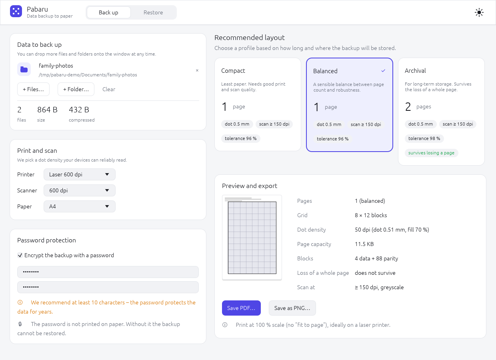
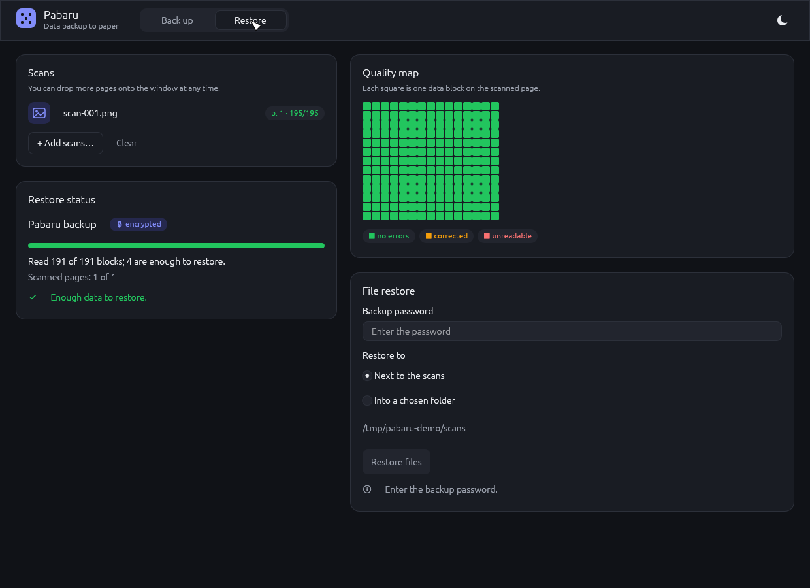

# Pabaru – data backup on paper

**Pabaru** (PAper BAckup in RUst) is a cross-platform tool (Windows, macOS, Linux) that backs up files and whole folders onto plain paper as a dense grid of dots, and restores them from a scan. Inspired by [PaperBack](https://www.ollydbg.de/Paperbak/index.html) by Oleg Yuschuk, the [Musashii-kun/paperbak](https://github.com/Musashii-kun/paperbak) fork and [PaperBack 2.0](https://github.com/mike-buffington/PaperBack-2.0). Pabaru uses its own format and implementation.

**Website & downloads:** <https://pabaru.kitai.cz> · **Releases:** [GitHub Releases](https://github.com/j3corre/pabaru/releases/latest) · **Format specification:** [docs/SPEC.md](docs/SPEC.md)

> Status: **version 0.3**. Resistance to crumpling and tearing has been verified on real prints and scans. See [CHANGELOG.md](CHANGELOG.md).



## Features
- **CLI and GUI** (egui), both built on the same library, `pabaru-core`.
- **Drag & drop folders:** the app suggests 3 layouts (Compact / Balanced / Archival) with page count and resilience.
- **Modern format v1:**
  - tar + zstd for folders, manifest with BLAKE3 hashes,
  - optional encryption with Argon2id + XChaCha20-Poly1305,
  - two-level error correction: Reed-Solomon inside each block and an erasure code across blocks and pages,
  - any scan orientation (rotation and mirroring are detected automatically).
- **Output:** PDF (print at 100 % scale) or PNG.
- **Restore input:** PNG/TIFF/JPEG/BMP scans or a PDF from the scanner, pages in any order, from multiple copies.
- **Several folders at once:** folders with the same name from different places don't overwrite each other. Files are restored next to the scans (into the folder the scans were loaded from) or into a chosen folder.
- **Privacy:** the backup doesn't contain original absolute paths, and neither the backup name nor file names are printed on the paper. The page header only says "Pabaru paper backup", the page number, print parameters and possibly "encrypted".
- **Open format:** [docs/SPEC.md](docs/SPEC.md) describes the format and decoding in enough detail (with test vectors) to write an independent reader. Your backups stay recoverable even without Pabaru.
- **Language:** the CLI is in English. The GUI is in English and Czech, picked from the system settings (override with `PABARU_LANG=en|cs`).

## Installation
Download a package for your system from [Releases](https://github.com/j3corre/pabaru/releases/latest) or from <https://pabaru.kitai.cz>:

| System | Package |
|---|---|
| macOS (Apple Silicon / Intel) | `Pabaru-macos-arm64.dmg` / `Pabaru-macos-x64.dmg` |
| Windows | `Pabaru-windows-x64-setup.exe` or `Pabaru-windows-x64.msi` |
| Linux | `pabaru_amd64.deb` or `Pabaru-x86_64.AppImage` |
| CLI only | `pabaru-cli-<target>.tar.gz` / `.zip` |

The packages are **not code-signed** yet:
- **macOS:** open the app once; when macOS says it can't verify the developer, go to *System Settings → Privacy & Security* and click *Open Anyway* (on macOS 14 and older, right-click the app → *Open* also works). Alternatively: `xattr -dr com.apple.quarantine /Applications/Pabaru.app`.
- **Windows:** in the SmartScreen dialog click *More info → Run anyway*.
- **Linux:** `sudo apt install ./pabaru_amd64.deb`, or `chmod +x Pabaru-x86_64.AppImage` and run it.

The desktop packages also contain the `pabaru` command-line tool (on macOS it is at `/Applications/Pabaru.app/Contents/MacOS/pabaru`).

From source (Rust 1.88+):
```sh
cargo install --git https://github.com/j3corre/pabaru pabaru-cli   # CLI
cargo install --git https://github.com/j3corre/pabaru pabaru-gui   # GUI
```

## Desktop app (GUI)
- **Backup:** drag files or folders into the window (several at once is fine). The app packs the data and offers three layouts: Compact / Balanced / Archival (page count, dot density, required scan resolution, resilience). Choose printer, scanner and paper, optionally enter a password, and save the PDF.
- **Restore:** drag in the scanned pages (PNG/JPEG/TIFF/BMP or a PDF from the scanner). The app shows progress and a quality map of every page, and after you enter the password (if any) it restores the files next to the scans or into a chosen folder.



## Command line
```sh
# Backup to PDF (A4, 600 dpi laser, 200 dpi dots, 20 % parity)
pabaru encode ./photos ./documents -o backup.pdf

# More robust backup: survives losing a whole page, encrypted with a password
pabaru encode ./documents -o backup.pdf --survive-page-loss --encrypt

# Pages as PNG (e.g. for your own printing workflow)
pabaru encode ./documents -o ./pages

# Restore from scans (order doesn't matter)
pabaru decode scan*.png -o ./restored
pabaru decode scan*.png                    # without -o: into the folder of the first scan

# Check a single scan: block quality map
pabaru inspect scan1.png

# Test without a printer: simulated print and scan (+ losing page 1)
pabaru verify ./documents --survive-page-loss --drop-page 1
```

### Automatic parameter suggestions
```sh
pabaru plan ./documents --printer laser600 --scanner-dpi 600 --paper a4
pabaru encode ./documents -o backup.pdf --profile archival --printer laser600 --scanner-dpi 600
```
`plan` packs the data and, for the profiles **Compact / Balanced / Archival**, computes the page count, dot density, minimum scan resolution and resilience (`--json` for scripts).

Manual parameters: `--paper a4|letter|WxH`, `--printer-dpi`, `--dot-dpi` (must divide the printer DPI), `--fill`, `--margin`, `--redundancy`, `--survive-page-loss`.

Restore also accepts **PDFs from a scanner** (`pabaru decode scan.pdf -o …`).

## Password encryption
- `pabaru encode … --encrypt` asks for the password twice. Data are encrypted (Argon2id + XChaCha20-Poly1305) before being split into blocks.
- The password is **never printed**. The paper only says "encrypted" and carries the key-derivation parameters.
- `pabaru decode` detects an encrypted backup and asks for the password. On a typo it allows 3 attempts without reloading the scans.
- A wrong password or corrupted data are detected reliably (authentication tag) and nothing is written to disk.
- For scripts: `--password-env VARIABLE_NAME`.

## Paper durability
- For small backups, **coarse dots** (up to 0.5 mm) are chosen automatically – they survive crumpling, folds and small tears.
- Just smooth a crumpled page and scan it. Multiple scans of the same page (or of different copies) are **combined** during restore.
- A torn page can be scanned whole or piece by piece.
- Try it without a printer: `pabaru verify <folder> --profile balanced --crumple medium --tear`.

## Printing and scanning tips
- Print on a laser printer without scaling ("Actual size / 100 %").
- Scan in greyscale at a resolution of at least 3× the dot density (≥ 600 dpi for 200 dpi dots), without sharpening.

## Limitations
- Backups larger than about 8 MB after compression (65,535 blocks) are not supported yet.
- Not tested yet: photos taken with a phone (perspective), wavy paper.
- Scanner PDFs with JBIG2/CCITT/JPEG2000 images are not supported.

## Development
```sh
cargo test --workspace
cargo clippy --workspace --all-targets -- -D warnings
cargo run -p pabaru-cli -- --help
cargo run -p pabaru-gui                              # desktop app
cargo test --release -p pabaru-scan -- --ignored     # full A4 page test
```

The GUI is built with egui, which browser automation tools can't drive. It is tested with `egui_kittest` (interactions simulated through AccessKit), and the view-model logic is covered by unit tests. Screenshots: `PABARU_SCREENSHOTS=<folder> cargo test -p pabaru-gui -- --ignored screenshots`.

Release packages are built by GitHub Actions ([.github/workflows/release.yml](.github/workflows/release.yml)) when a `v*` tag is pushed.

## Documentation
- [docs/SPEC.md](docs/SPEC.md) – specification of the printed format and decoding (for recovery without this program)
- [docs/ARCHITECTURE.md](docs/ARCHITECTURE.md) – architecture
- [CHANGELOG.md](CHANGELOG.md) – version history
- [CONTRIBUTING.md](CONTRIBUTING.md) – how to contribute

## License
Licensed under either of [Apache License, Version 2.0](LICENSE-APACHE) or [MIT license](LICENSE-MIT) at your option.

Unless you explicitly state otherwise, any contribution intentionally submitted for inclusion in this project, as defined in the Apache-2.0 license, shall be dual licensed as above, without any additional terms or conditions.

Binary packages include third-party components; their licenses are listed in `THIRD_PARTY_LICENSES.html` shipped with each package.
