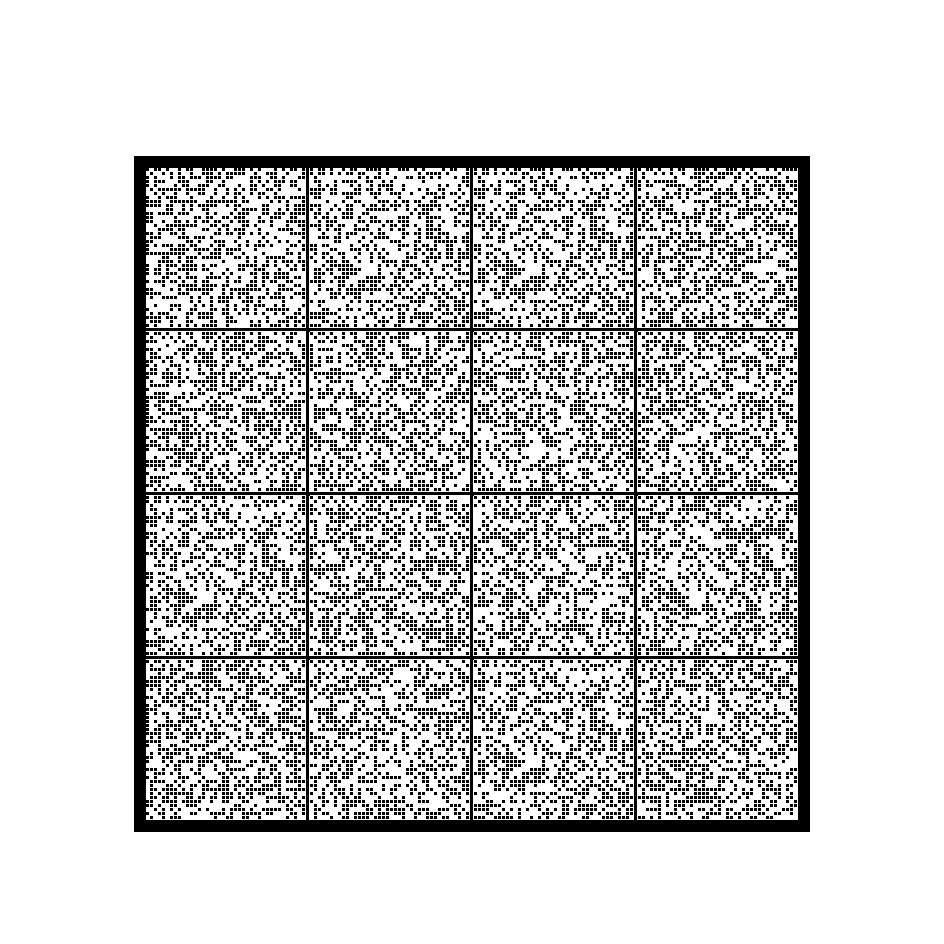

# Pabaru paper format – specification (format version 1)

**Status:** normative description of format version 1, as written by Pabaru 0.3.
Readers that implement this document can recover every backup Pabaru has ever printed
(see [§6.5](#65-differences-between-pabaru-releases) for differences between releases).

**Purpose.** A Pabaru backup is a stack of printed pages. This document describes them
precisely enough that a person with no access to Pabaru, its source code or any of its
dependencies can write an independent decoder, possibly decades from now. A secondary
audience is someone who wants to write a compatible encoder.

**Self-containment.** This document is complete on its own. References to files in the
Pabaru repository (the test file and the sample page image) are *informative*: they help
to check an implementation, but nothing normative depends on them. All the data needed
to reproduce the sample backup is printed in §10 and §11.

**Test vectors (informative).** Every concrete value in this document (hex dumps, tables,
hashes) is computed and checked by `crates/pabaru-core/tests/spec_vectors.rs`, and the
test fails if a value is missing from this document. That file also
contains an independent reference implementation of the pseudocode below (whitening,
CRC-32C, both Reed–Solomon codes, the shuffle and an ideal page reader). The tests compare
it with the production code and with the `reed-solomon-simd` library. If you change the
format, the tests fail.

---

## Contents

1. [Overview and conventions](#1-overview-and-conventions)
2. [Archive layer (tar + manifest + zstd)](#2-archive-layer)
3. [Encryption layer](#3-encryption-layer)
4. [Sharding and the outer erasure code](#4-sharding-and-the-outer-erasure-code)
5. [Blocks](#5-blocks)
6. [Superblock and distribution of blocks over pages](#6-superblock-and-pages)
7. [Page geometry and rendering](#7-page-geometry-and-rendering)
8. [Decoding scans (informative)](#8-decoding-scans-informative)
9. [Restore procedure – checklist](#9-restore-procedure--checklist)
10. [Test vectors](#10-test-vectors)
11. [Appendix: tables and constants](#11-appendix-tables-and-constants)

---

## 1. Overview and conventions

### 1.1 Layers

```
files ──► tar (manifest first) ──► zstd ──► [XChaCha20-Poly1305] ──► STREAM
STREAM ──► k data shards of 128 B ──► outer RS over GF(2^16) ──► k + m shards
shard  ──► header 8 B + payload 128 B + CRC-32C 4 B ──► inner RS(200,140) over GF(2^8)
       ──► whitening (XOR) ──► 200 B = 1600 bits = 40 × 40 dots
dots   ──► cells of a grid with solid grid lines and a thick frame ──► printed pages
```

Every page also carries at least 4 copies of a **superblock**, a special block that holds
the backup metadata (k, m, stream length, stream hash, KDF parameters, ...). It is
self-describing: one readable superblock copy on any page tells a decoder everything it
needs.

Decoding runs in reverse order:

1. Locate the dots on a scan and read every cell as 200 bytes.
2. Undo the whitening, then correct the bytes with the inner Reed–Solomon code and check
   the CRC. A cell that fails is simply missing; nothing else needs to know about it.
3. Group the blocks by `backup_id`. Take the metadata from a superblock.
4. Rebuild the missing data shards from any `k` of the `k + m` shards using the outer code.
5. Concatenate the shards, truncate them to the stream length and verify the BLAKE3 hash.
6. Decrypt the stream if it is encrypted, then decompress it with zstd and unpack the tar.

### 1.2 Conventions

* The key words MUST, MUST NOT, SHOULD and MAY are used as in RFC 2119.
* All multi-byte integers are **little-endian** unless stated otherwise.
* Byte offsets and indices start at 0. `a ‖ b` is concatenation. `⊕` and `^` are XOR.
* **Ranges.** `a ..= b` is the *inclusive* range `a, a+1, …, b` (used in loops and index
  sets). `a .. b` is the *half-open* range `a, …, b−1` (used for slices: `X[a .. b]` is the
  `b − a` elements starting at `a`; `X[a ..]` runs to the end). A range whose end is below
  its start is empty. In the pseudocode, `for i = x, x+s, x+2s, … < n` steps by `s` while
  `i < n`.
* **Bit order inside a byte.** Bit 0 is the **most significant** bit (`0x80`). This is
  used only in the bit → dot mapping (§5.5).
* **Colour.** A black (printed) dot is a 1 bit. A white (blank) dot is a 0 bit.
* Hex dumps show 16 bytes per line in file order.
* `⌈a/b⌉` is ceiling division. `next_pow2(n)` is the smallest power of two ≥ n
  (`next_pow2(1) = 1`).
* A *dot* is the logical unit of the printed grid. One dot is `px_per_dot × px_per_dot`
  printer pixels (§7).

### 1.3 External algorithms

Pabaru relies on these published algorithms. Each one is identified so that it can be
re-implemented from its own specification.

| Algorithm | Reference | Used for |
|---|---|---|
| tar (GNU/ustar header) | POSIX.1-1988 ustar, GNU tar manual | archive (§2) |
| zstd | RFC 8878 | compression (§2) |
| JSON | RFC 8259 | manifest (§2) |
| BLAKE3 | BLAKE3 specification (O'Connor, Aumasson, Neves, Wilcox-O'Hearn, 2020) | stream hash, file hashes |
| Argon2id, version 0x13 | RFC 9106 | key derivation (§3) |
| XChaCha20-Poly1305 | draft-irtf-cfrg-xchacha-03 (on top of RFC 8439) | encryption (§3) |
| CRC-32C (Castagnoli) | RFC 3720 §B.4 | block checksum (§5.2) |
| Reed–Solomon over GF(2^8) | textbook (e.g. Blahut, *Algebraic Codes for Data Transmission*) | inner code (§5.3) |
| Additive-FFT Reed–Solomon over GF(2^16) | Lin, Chung, Han: *Novel polynomial basis and its application to Reed–Solomon erasure codes*, FOCS 2014. Leopard-RS (C. Taylor), `reed-solomon-simd` 3.1.0 | outer code (§4), fully specified here |

---

## 2. Archive layer

### 2.1 Stream before encryption

The *packed stream* is

```
packed = zstd_compress( tar_archive )
```

* Pabaru writes **one zstd frame** (level 19 by default, levels 1–22 allowed; the level
  does not affect decoding). A reader MUST accept any valid zstd data (RFC 8878).
* Flag bit 0 of the superblock ("compressed", §6.2) is always set by Pabaru. The reference
  reader ignores the flag and **always** decompresses with zstd.

### 2.2 tar archive

The archive is produced by the Rust crate `tar` 0.4 with **GNU-style headers**
(`magic = "ustar "`, `version = " \0"`, 512-byte blocks). It ends with two all-zero
512-byte blocks. It is *not* padded to a 10240-byte record.

Entries, in order:

1. **`.pabaru/manifest.json`** – always the first entry. Typeflag `NUL` (regular file),
   mode `0644`, mtime 0, uid/gid fields empty (all zero bytes), size = JSON length.
2. For every *root* (§2.4) in sorted order: the root itself, then its contents
   depth-first. Inside each directory, entries are sorted by file name (byte order of
   the OS file name). Each entry is either:
   * a **directory** (typeflag `5`, size 0, the name has **no** trailing `/`), or
   * a **regular file** (typeflag `0`).

   Symbolic links, devices, FIFOs and sockets are skipped and never stored.

Header fields of directory and file entries are copied from the file system: mtime
(seconds since 1970-01-01 UTC), uid, gid and mode. On Unix the mode field contains the
complete `st_mode`, *including* the file-type bits (e.g. `0100644` for a regular file).
Readers SHOULD use only `mode & 0o7777`. The uname/gname fields are empty and device
numbers are 0.

Numeric header fields are normally octal ASCII terminated by NUL or space. In the manifest
entry, however, the uid and gid fields consist of **NUL bytes only** (no digits at all).
Readers MUST treat an all-NUL (or empty) numeric field as 0. They SHOULD also accept the
GNU base-256 encoding (first byte with the high bit set), which the `tar` crate uses for
values that do not fit in octal. Only `size` and the typeflag matter for extraction; the
other fields are metadata.

**Long names.** A GNU header holds a name of at most 100 bytes and has no ustar prefix
field. For longer names Pabaru (via the `tar` crate) emits a GNU long-name pseudo-entry
before the real header:

* name `././@LongLink`, typeflag `L`;
* data = full path bytes followed by one `NUL` (size = length + 1), padded to 512 bytes.

The real header that follows holds the first 100 bytes of the name, and readers MUST use
the long name instead. A reader SHOULD also accept PAX (`x`) and GNU `K` records, since
any standard tar library does.

**Path rules.**

* Paths are relative and use `/` as the separator. A path MUST NOT be empty, MUST NOT be
  absolute (no leading `/`, no drive letter) and MUST NOT contain `.` or `..` components.
  The Pabaru reader rejects such entries and fails the restore (it treats them as an
  attack).
* Names are UTF-8. Bytes that are not valid UTF-8 on the source system were replaced by
  U+FFFD at backup time.
* A reader MAY strip a trailing `/` from directory names. On Windows, readers convert `\`
  to `/` before checking.

### 2.3 Manifest `.pabaru/manifest.json`

UTF-8 JSON, pretty-printed with two-space indentation (the formatting carries no
meaning). Fields:

| Field | Type | Meaning |
|---|---|---|
| `version` | integer | Manifest version, currently `1`. |
| `roots` | array of objects | The inputs the user selected (files or folders). Each object has `name` (string), the name of the root inside the archive. The array may be missing in very old manifests; treat a missing array as empty. |
| `files` | array of objects | One entry per **regular file**, in archive order. |
| `files[].path` | string | Path inside the archive (same as the tar name). |
| `files[].size` | integer | File size in bytes. |
| `files[].blake3` | string | BLAKE3-256 of the file content, 64 lowercase hex digits. |

Readers MUST ignore unknown fields. Manifests written before Pabaru 0.3 contain an
additional `roots[].original` field (the absolute source path), which MUST be ignored.

After unpacking, a reader SHOULD verify every `files[]` entry: the file exists at `path`
and its BLAKE3 hash equals `blake3`. Pabaru reports a restore as failed otherwise.

Example (the tiny backup of §10.7):

```json
{
  "version": 1,
  "roots": [
    {
      "name": "hello.txt"
    }
  ],
  "files": [
    {
      "path": "hello.txt",
      "size": 14,
      "blake3": "1e2d86e062b69f53aab70501467d18c81dce9252b086930a551966d4cf92c5f9"
    }
  ]
}
```

### 2.4 Root naming (informative)

The archive names of the roots are relative to the deepest common ancestor of all
selected inputs. A single input keeps only its own name (`hello.txt`). Two inputs
`/a/x/docs` and `/a/y/docs` become `x/docs` and `y/docs`. On Windows, inputs on different
drives have no common ancestor and start with the drive letter (`C/work/docs`). An input
that lies inside another input is dropped. Absolute source paths are **not** stored
anywhere in the backup.

---

## 3. Encryption layer

Encryption is optional and is indicated by flag bit 1 in the superblock (§6.2).

* Without encryption: `STREAM = packed`.
* With encryption: `STREAM = nonce (24 B) ‖ ciphertext ‖ tag (16 B)`, where
  `ciphertext ‖ tag = XChaCha20-Poly1305-Encrypt(key, nonce, plaintext = packed, aad = "")`.
  This is the "combined" output of the AEAD with the 16-byte Poly1305 tag appended.
  Encryption adds exactly 40 bytes.

### 3.1 Key derivation

```
key (32 bytes) = Argon2id(
    password = UTF-8 bytes of the password, exactly as typed (no normalisation, no trailing newline),
    salt     = superblock.kdf_salt (16 bytes),
    m        = superblock.kdf_mem_kib      (memory in KiB),
    t        = superblock.kdf_iterations   (passes),
    p        = superblock.kdf_parallelism  (lanes),
    version  = 0x13,
    secret   = empty, associated data = empty,
    tag length = 32)
```

Pabaru's default parameters are `m = 65536` (64 MiB), `t = 3`, `p = 1`. The salt and the
nonce come from the operating system's cryptographic RNG, and both are fresh for every
backup.

### 3.2 What is protected

* The AEAD authenticates the ciphertext only (**AAD is empty**). The superblock is **not**
  authenticated. A wrong password and a damaged stream both show up as a tag failure; a
  reader cannot tell the two apart.
* The BLAKE3 stream hash in the superblock (§6.2) is computed over the **stored STREAM**,
  i.e. over the encrypted bytes when encryption is used. It can therefore be checked
  *before* decryption and without the password. It detects outer-code failures. It does
  not protect against deliberate tampering.
* The KDF fields of the superblock are all zero for unencrypted backups.

---

## 4. Sharding and the outer erasure code

### 4.1 Shards

Let `L = len(STREAM)`. Then

```
k = max(1, ⌈L / 128⌉)                         number of data shards
data_shard[i] = STREAM[128·i .. 128·i + 128]   (i = 0 ..= k−1), the last one zero-padded to 128 B
```

`m` parity shards (`parity_shard[0 ..= m−1]`) are computed by the outer code from the data
shards. The shards get **global indices**: `0 ..= k−1` for data, `k ..= k+m−1` for parity
(`index = k + r` for `parity_shard[r]`). A reader that has any `k` distinct shards can
recover all data shards. Without parity (`m = 0`, which is allowed) every data shard is
needed.

How Pabaru chooses `m` (informative; a reader takes `m` from the superblock): first
`m = ⌈k · redundancy_pct / 100⌉`. Then `m` is increased until every page is completely
full (§6.3). With the "survive page loss" option it is increased further, until `m` is at
least the number of shards on one page.

**Limits.** Pabaru never writes a backup with `k + m > 65535`; it refuses to encode
larger data. There is no interleaving of several codes: one backup is always exactly one
outer codeword. In addition, `(k, m)` must be supported by the code: `k ≥ 1`, `m ≥ 1` and

```
min(next_pow2(k), next_pow2(m)) + max(k, m) ≤ 65536
```

For example, `(60000, 4000)` is valid but `(60000, 5000)` or `(40000, 25000)` are not.
The encoder fails for such combinations and no such backup exists.

**Shard bytes → field symbols.** The outer code works on 16-bit symbols, independently
for each *symbol position*. A 128-byte shard holds **64 symbols**. They are **not** stored
as consecutive little-endian pairs. The shard is split into two 64-byte halves, and in
each half the first 32 bytes are the low bytes and the last 32 bytes are the high bytes:

```
symbol j (0 ≤ j < 64):
    base   = 64 · ⌊j / 32⌋ + (j mod 32)
    lo     = shard[base]
    hi     = shard[base + 32]
    symbol = lo | (hi << 8)
```

So symbol 0 is bytes 0 and 32, symbol 31 is bytes 31 and 63, symbol 32 is bytes 64 and 96,
and symbol 63 is bytes 95 and 127. Parity shards use the same layout. The code is applied
separately to each of the 64 *columns*: `col_j = (symbol j of data shard 0, …, symbol j
of data shard k−1)` yields symbol j of every parity shard. Everything below therefore
works on one column of `k` symbols at a time.

> Background: this is the memory layout of `reed-solomon-simd` 3.1.0 (and Leopard-RS),
> chosen for SIMD. Because 128 is a multiple of 64, the library's special handling of a
> trailing partial 64-byte chunk never applies.

### 4.2 The field GF(2^16) in the Cantor basis

The outer code is defined over GF(2^16). Its elements are represented by 16-bit integers
**in a non-standard basis**:

* Addition is XOR of the 16-bit integers (in any basis).
* Multiplication is defined by the tables `LOG` and `EXP` below. They are *not* the usual
  polynomial-basis tables.

#### 4.2.1 Constants

```
GF_POLYNOMIAL = 0x1002D            (x^16 + x^5 + x^3 + x^2 + 1)
CANTOR_BASIS  = [0x0001, 0xACCA, 0x3C0E, 0x163E, 0xC582, 0xED2E, 0x914C, 0x4012,
                 0x6C98, 0x10D8, 0x6A72, 0xB900, 0xFDB8, 0xFB34, 0xFF38, 0x991E]
MODULUS       = 65535              (order of the multiplicative group)
```

#### 4.2.2 Tables

```
# Step 1: discrete logarithm in the polynomial basis (generator = the polynomial "x" = 2).
lfsr_log = array[65536]
state = 1
for i in 0 ..= 65534:                # 65535 iterations
    lfsr_log[state] = i
    state = state << 1
    if state ≥ 65536: state = state XOR GF_POLYNOMIAL
lfsr_log[0] = 65535                   # sentinel for the zero element

# Step 2: value in the Cantor basis -> value in the polynomial basis.
poly = array[65536]; poly[0] = 0
for i in 0 ..= 15:
    w = 1 << i
    for j in 0 ..= w−1:
        poly[j + w] = poly[j] XOR CANTOR_BASIS[i]

# Step 3: LOG and EXP for the Cantor representation.
for x in 0 ..= 65535: LOG[x] = lfsr_log[poly[x]]
for x in 0 ..= 65535: EXP[LOG[x]] = x
EXP[65535] = EXP[0]                   # = 1
```

The integer `x` therefore stands for the field element `poly[x]` (the XOR of the basis
vectors selected by the bits of `x`). `LOG[1] = 0` and `LOG[0] = 65535` (sentinel).

Field operations, for `a, b` in `0 ..= 65535`:

```
mul(a, b) = 0                                         if a = 0 or b = 0
          = EXP[(LOG[a] + LOG[b]) mod 65535]          otherwise
inv(a)    = EXP[(65535 − LOG[a]) mod 65535]           (a ≠ 0)
```

> **Implementation note (sentinel).** The library stores logarithms as `u16` and adds them
> with an end-around carry (`s = a + b; (s + (s >> 16)) mod 65536`). The value 65535 is
> then a second representation of the logarithm 0, which is why `EXP[65535] = EXP[0]`.
> In its skew table (below), 65535 = `LOG[0]` means "the factor is the zero element" and
> the multiplication is skipped. If you work with field *elements* as in this document,
> both cases are handled automatically, since multiplying by the element 0 gives 0.

#### 4.2.3 Skew factors

The FFTs use a table `SKEW[0 ..= 65534]` of field elements:

```
temp = array[15]; for i in 1 ..= 15: temp[i−1] = 1 << i
SKEW = array[65535] filled with 0
for m in 0 ..= 14:
    step = 1 << (m + 1)
    SKEW[(1 << m) − 1] = 0
    for i in m ..= 14:
        s = 1 << (i + 1)
        j = (1 << m) − 1
        while j < s:
            SKEW[j + s] = SKEW[j] XOR temp[i]
            j = j + step
    d = mul(temp[m], temp[m] XOR 1)
    for i in m+1 ..= 14:
        temp[i] = mul( mul(temp[i], temp[i] XOR 1), inv(d) )
```

(`temp[i]` are values of the normalised subspace vanishing polynomials, as in
Lin–Chung–Han. The library stores `LOG[SKEW[i]]` instead of `SKEW[i]`.)
Spot values: `SKEW[0 .. 8] = 0000 0000 0002 0000 0004 0002 0006 0000`, `SKEW[65534] = fffe`.

### 4.3 Additive FFT and IFFT

Both transforms work in place on an array `A` whose length `n` is a power of two. They
take a *skew offset* `δ`, which selects the evaluation points. All products are `mul`
from §4.2. Butterflies use the field element `s` from `SKEW` (if `s = 0` the product is
0; implementations may skip it).

```
FFT(A, δ):                                   # n = len(A)
    dist = n / 2
    while dist ≥ 1:
        for r = 0, 2·dist, 4·dist, … < n:
            s = SKEW[r + dist + δ − 1]
            for i in r ..= r + dist − 1:
                A[i]        ^= mul(s, A[i + dist])
                A[i + dist] ^= A[i]
        dist = dist / 2

IFFT(A, δ):
    dist = 1
    while dist < n:
        for r = 0, 2·dist, 4·dist, … < n:
            s = SKEW[r + dist + δ − 1]
            for i in r ..= r + dist − 1:
                A[i + dist] ^= A[i]
                A[i]        ^= mul(s, A[i + dist])
        dist = dist · 2
```

`IFFT(·, δ)` is the exact inverse of `FFT(·, δ)`. For `n = 1` both are the identity.

The **formal derivative** in the novel polynomial basis is

```
FORMAL_DERIVATIVE(A):                        # n = len(A), in place, i ascending
    for i in 1 ..= n−1:
        w = 1 << (number of trailing zero bits of i)
        for j in 0 ..= w−1:
            A[i − w + j] ^= A[i + j]
```

> The library also has *truncated* versions of these transforms. They skip butterfly
> groups whose inputs are known to be zero (IFFT) or whose outputs are not needed (FFT).
> They give the same values at every position that is used. This document always uses
> the full transforms on explicitly zero-padded arrays.

### 4.4 Encoding

The library has two encoders, *high rate* and *low rate*. They produce **different**
parity, and a decoder has to use the same one the encoder used. The choice is
deterministic:

```
USE_HIGH_RATE(k, m):
    kp = next_pow2(k); mp = next_pow2(m)
    if kp > mp: return true
    if kp < mp: return false
    return k ≤ m              # equal powers of two: high rate iff k ≤ m (deliberately "inverted")
```

Examples: (3,2) high, (2,5) low, (3,4) high, (4,3) **low**, (4,4) high, (1,1) high,
(1,m>1) low. Small Pabaru backups usually have a small `k` and a larger `m` (parity fills
the page), so the **low-rate** branch is the common case in practice.

For one column `d[0 ..= k−1]` (symbols of the data shards at one symbol position):

```
ENCODE_HIGH(d, m):                    # T = chunk size
    T = next_pow2(m)
    acc = [0] · T
    for c = 0, 1, … while c·T < k:
        buf = [d[c·T + i] if c·T + i < k else 0  for i in 0 ..= T−1]
        IFFT(buf, δ = c·T + T)
        acc = acc XOR buf                     (element-wise)
    FFT(acc, δ = 0)
    return acc[0 ..= m−1]                     # parity symbols 0 ..= m−1

ENCODE_LOW(d, m):
    T = next_pow2(k)
    buf = d[0 ..= k−1] followed by T − k zeros
    IFFT(buf, δ = 0)
    parity = []
    for c = 0, 1, … while c·T < m:
        out = copy of buf
        FFT(out, δ = c·T + T)
        append out[i] for i in 0 ..= T−1 while c·T + i < m
    return parity                             # m symbols
```

Consequences worth knowing:

* With `k = 1` (low rate, `T = 1`) every parity shard is an exact copy of the data shard.
* The code is linear over GF(2^16), it is systematic (the data shards are sent
  unchanged), and it is MDS: any `k` of the `k + m` shards determine the data.

Byte-level procedure: for every symbol position `j = 0 ..= 63`, collect column `j` from
the data shards, encode it, and store parity symbol `r` at position `j` of
`parity_shard[r]` (low byte at `base`, high byte at `base + 32`, as in §4.1).

### 4.5 Decoding (erasure recovery)

Input: `k`, `m`, and some of the shards with their global indices (at least `k` in
total). The output is all missing data shards. If no data shard is missing there is
nothing to do. Parity shards are never needed as output.

Decoding uses a single evaluation domain of positions `0 ..= 65535`. The shards occupy
these positions:

| Rate | Data shard `i` | Parity shard `r` (global index `k + r`) | Other positions |
|---|---|---|---|
| high (`T = next_pow2(m)`) | position `T + i` | position `r` | `m ..= T−1`: **erased** (padding); `≥ T + k`: known zero |
| low (`T = next_pow2(k)`) | position `i` | position `T + r` | `k ..= T−1`: known zero; `≥ T + m`: **erased** |

A position is **erased** if it belongs to a missing shard, or if the table marks it as
erased. Let `E` be the set of erased positions, `N = T + k` (high rate) or `N = T + m`
(low rate), and `W = next_pow2(N)`.

```
DECODE(column of received symbols):
    # 1. Error-locator values: product over the erased positions (i ⊕ j is the field sum).
    for i in 0 ..= W−1:
        loc[i] = Π_{j ∈ E, j ≠ i}  (i XOR j)          # mul from §4.2; empty product = 1

    # 2. Weight the received symbols.
    work = [0] · W
    for every received shard at position p:
        work[p] = mul(symbol, loc[p])
    # erased and known-zero positions stay 0

    # 3. Transform.
    IFFT(work, δ = 0)
    FORMAL_DERIVATIVE(work)
    FFT(work, δ = 0)

    # 4. Read out the missing data symbols.
    for every missing data shard i:
        p = position of data shard i (T + i for high rate, i for low rate)
        symbol_i = mul(work[p], inv(loc[p]))
```

Apply this to all 64 columns, then write the symbols back into 128-byte shards (§4.1).

**Cheaper direct locator (optional, informative).** The erased positions `j ≥ W` can be
left out of the product, giving `loc'[i] = Π_{j ∈ E, j < W, j ≠ i} (i ⊕ j)`, which costs
`O(W²)`. This is valid for two reasons:

* For `i < W` and `j ≥ W` the factor is never zero, and the omitted part
  `c = Π_{j ∈ E, j ≥ W} (i ⊕ j)` is the same for every `i < W`. In high rate, `E` has no
  positions `≥ N`, so `c = 1`. In low rate, `E ⊇ [W, 65536)`; because `W` is a power of
  two, `j ↦ i ⊕ j` permutes `[W, 65536)`, so `c` is the product of all elements of that
  range, independent of `i`.
* DECODE multiplies the inputs by `loc[p]`, applies only linear operations, and divides by
  `loc[p]` at the end. Scaling every `loc` value by the same non-zero `c` therefore cancels.

The definition above (over the whole of `E`) stays the normative one. The test suite
checks that all three locators give identical recovered data in both branches.

**Fast locator (optional).** Computing `loc` directly costs `O(W · |E|)` multiplications.
For low rate `E` always contains all positions `N ..= 65535`, so the direct method costs
about `W · 65536` multiplications. That is fine for small backups and slow for large ones.
The library computes the *logarithms* of `loc` for all 65536 positions at once with a fast
Walsh–Hadamard transform (FWHT) over the integers modulo 65535:

```
FWHT(v):                    # len 65536, values mod 65535, in place
    h = 1
    while h < 65536:
        for each block start b = 0, 2h, 4h, …:
            for j in b ..= b+h−1:
                (v[j], v[j+h]) = ((v[j] + v[j+h]) mod 65535, (v[j] − v[j+h]) mod 65535)
        h = 2h

LW = [LOG[x] for x in 0 ..= 65535]; LW[0] = 0;  FWHT(LW)       # constant table
e  = [1 if x ∈ E else 0 for x in 0 ..= 65535];  FWHT(e)
for x: e[x] = (e[x] · LW[x]) mod 65535
FWHT(e)
loc[i] = EXP[e[i]]
```

This works because `log loc[i] = Σ_{j∈E} LOG'[i ⊕ j]` (with `LOG'[0] = 0`) is a
XOR-convolution. Applying the transform twice multiplies by 65536 ≡ 1 (mod 65535), so no
normalisation is needed. The test suite checks that both methods agree.

**Fallback decoder (any `k`, `m`, any method).** The code is linear, and every column
uses the same map. An implementer who has only a correct *encoder* can therefore decode
as follows:

1. Build the generator matrix `G` (m × k). Column `i` of `G` is the output of
   `ENCODE_HIGH/LOW` for the unit vector `e_i` (symbol 1 at shard `i`, 0 elsewhere).
2. For each column, take any `k` received equations: a received data shard `i` gives
   `d_i = value`, and a received parity shard `r` gives `Σ_i G[r][i]·d_i = value`.
3. Solve the `k × k` system by Gaussian elimination over GF(2^16) (using `mul`, `inv` and
   XOR). The system is always non-singular because the code is MDS.

The cost is `O(k^3)` once per backup plus `O(k^2)` per column. This is practical for `k`
up to a few thousand. It is the most robust option if the FFT description above is ever
in doubt.

### 4.6 Verifying an implementation

[§10.5](#105-outer-code) gives parity values for small examples in both branches
(including the inverted case), a full 128-byte shard example and a recovery example.
An implementation that matches those has the conventions right (Cantor basis, skew,
rate selection, byte layout).

---

## 5. Blocks

A **block** is the 200-byte unit printed in one grid cell as 40 × 40 dots.

### 5.1 Layout

Data part (140 bytes, protected by the inner code):

| Offset | Length | Field |
|---:|---:|---|
| 0 | 4 | `backup_id` (u32), a random identifier of the backup, the same in all its blocks |
| 4 | 4 | `index` (u32): global shard index `0 ..= k+m−1`, or `0xFFFFFFFF` for a superblock |
| 8 | 128 | payload: the shard, or the superblock (§6) |
| 136 | 4 | CRC-32C (u32 LE) of bytes 0 ..= 135 |

Codeword (200 bytes) = data part (140 B) ‖ RS parity (60 B), see §5.3.
Printed block = codeword XOR whitening sequence (§5.4).

### 5.2 CRC-32C

CRC-32C (Castagnoli): reflected polynomial `0x82F63B78` (normal form `0x1EDC6F41`),
initial value `0xFFFFFFFF`, reflected input and output, final XOR `0xFFFFFFFF`. Check
value: `CRC32C("123456789") = 0xE3069283`.

```
crc = 0xFFFFFFFF
for each byte b:
    crc ^= b
    repeat 8 times: crc = (crc >> 1) ^ 0x82F63B78 if crc & 1 else crc >> 1
crc = crc ^ 0xFFFFFFFF
```

The CRC is a second safeguard. It catches the rare case where the inner RS decoder
"corrects" a badly damaged block into a different valid codeword. A reader MUST reject a
block whose CRC does not match after RS decoding.

### 5.3 Inner code: RS(200, 140) over GF(2^8)

#### 5.3.1 Field and generator

* GF(2^8) with primitive polynomial `0x11D` (x^8 + x^4 + x^3 + x^2 + 1), primitive
  element `α = 2` (the usual "QR-code" field). Addition is XOR.
  `EXP8[i] = α^i` is generated by `x = 1; repeat: x <<= 1; if x & 0x100: x ^= 0x11D`.
* First consecutive root `fcr = 0`. The generator polynomial is
  `g(x) = Π_{i=0}^{59} (x − α^i)`, with 61 coefficients. Its coefficients are listed in
  [§11.1](#111-inner-rs-generator-polynomial).
* Codeword polynomial convention: **byte 0 is the coefficient of the highest power**.
  The codeword `c[0 ..= 199]` is `c(x) = Σ_p c[p] · x^(199 − p)`. Byte `p` therefore has the
  *locator* `X_p = α^(199 − p)`.

#### 5.3.2 Encoding (systematic)

```
c[0 ..= 139]   = data part (§5.1)
c[140 ..= 199] = coefficients (highest power first) of  (data(x) · x^60) mod g(x)
```

Equivalent LFSR form (`g[0] = 1` is the x^60 coefficient, `g[1 ..= 60]` the others,
highest first):

```
rem = [0] · 60
for each data byte b (in order 0 ..= 139):
    f = b XOR rem[0]
    shift rem left by one (rem[59] = 0)
    for j in 0 ..= 59: rem[j] ^= mul8(g[j + 1], f)
parity = rem
```

#### 5.3.3 Decoding with errors and erasures

The code corrects any combination of `ν` unknown errors and `ρ` erasures (byte positions
known to be unreliable) with `2ν + ρ ≤ 60`. Without erasures that is up to 30 bytes.
Every correct RS decoder gives the same result within this radius. One standard choice
(Berlekamp–Massey with erasures, Chien search, Forney):

```
INPUT: r[0 ..= 199] (de-whitened), erasure positions P (|P| = ρ ≤ 60)

1. Syndromes:  S_j = r(α^j) = Σ_p r[p] · α^(j·(199−p)),   j = 0 ..= 59.
   If all S_j = 0: the word is valid, done.
2. Erasure locator  Γ(x) = Π_{p∈P} (1 + X_p · x)        (coefficients lowest power first)
3. Berlekamp–Massey initialised with Γ:
       Λ = Γ;  B = Γ;  L = ρ
       for K = ρ+1 ..= 60:
           Δ = Σ_{j=0}^{L} Λ_j · S_{K−1−j}        (terms with K−1−j < 0 omitted)
           if Δ = 0:  B = x·B;  continue
           Tmp = Λ − Δ·x·B
           if 2L ≤ K + ρ − 1:  L = K + ρ − L;  B = Δ^(−1)·Λ
           else:               B = x·B
           Λ = Tmp
   Coefficients of Λ beyond its current length count as 0 in the Δ sum, and the
   subtraction `Λ − Δ·x·B` extends Λ with zeros as needed. `deg Λ` is the index of the
   highest **non-zero** coefficient (trailing zero coefficients of the array are ignored).
   Fail if deg Λ ≠ L or 2(L − ρ) + ρ > 60.
4. Chien search: errata positions = { p in 0 ..= 199 : Λ(X_p^(−1)) = 0 }.
   Fail if their number ≠ deg Λ.
5. Forney (fcr = 0):  Ω(x) = S(x)·Λ(x) mod x^60, with S(x) = Σ_{j=0}^{59} S_j x^j
       for each errata position p:
           r[p] ^= X_p · Ω(X_p^(−1)) / Λ'(X_p^(−1))
   where Λ' is the formal derivative (only odd-power terms survive in characteristic 2).
6. Recompute the syndromes; fail unless all are 0. Then check the CRC (§5.2).
```

Erasures are optional. Pabaru's scanner marks the bytes with the least confident dots as
erasures, and only after a plain decode has failed (§8.6).

### 5.4 Whitening

The 200-byte codeword is XORed with a fixed sequence `W[0 ..= 199]` so that blocks of
zeros (padding, headers) do not print as large white or black areas:

```
state = 0x50414252                  (u32; the ASCII bytes "PABR")
for i in 0 ..= 199:
    state ^= (state << 13) mod 2^32
    state ^=  state >> 17
    state ^= (state << 5)  mod 2^32
    W[i] = state >> 24               (top byte)
printed[i] = codeword[i] XOR W[i]
```

XOR is its own inverse, so a reader XORs the 200 bytes it read with `W` *before* RS
decoding. The first 32 bytes of `W` are in [§10.1](#101-whitening).

### 5.5 Bit → dot mapping

Bit number `d = 8·i + b` of the printed block (byte `i`, bit `b`, **`b = 0` is the MSB**)
is the dot at

```
x = d mod 40     (column, left to right)
y = d div 40     (row, top to bottom)
```

so bytes fill the square row by row, 5 bytes per row. A 1 bit is a black dot. The origin
is the top-left corner of the cell as printed (see §7 for the orientation on a scan).

---

## 6. Superblock and pages

### 6.1 The superblock block

A superblock is an ordinary block (§5) with `index = 0xFFFFFFFF`, the backup's
`backup_id`, and the 128-byte superblock record below as its payload.

### 6.2 Superblock record (128 bytes)

| Offset | Length | Type | Field |
|---:|---:|---|---|
| 0 | 4 | bytes | magic `PBRU` (`50 42 52 55`) |
| 4 | 1 | u8 | format version = `1` |
| 5 | 1 | u8 | flags: bit 0 (`0x01`) = zstd-compressed (always set); bit 1 (`0x02`) = encrypted; other bits 0 (readers ignore them) |
| 6 | 8 | u64 | `stream_len`: length of the stored STREAM in bytes |
| 14 | 4 | u32 | `k`: number of data shards |
| 18 | 4 | u32 | `m`: number of parity shards |
| 22 | 2 | u16 | page index (0-based) of the page that carries this copy |
| 24 | 2 | u16 | page count |
| 26 | 2 | u16 | grid columns (cells) per page |
| 28 | 2 | u16 | grid rows (cells) per page |
| 30 | 16 | bytes | first 16 bytes of BLAKE3-256(STREAM) |
| 46 | 16 | bytes | Argon2id salt (zero if not encrypted) |
| 62 | 4 | u32 | Argon2 memory in KiB (0 if not encrypted) |
| 66 | 4 | u32 | Argon2 iterations (0 if not encrypted) |
| 70 | 1 | u8 | Argon2 parallelism (0 if not encrypted) |
| 71 | 1 | u8 | `label_len`: length of the backup label in bytes, `label_len ≤ 56` |
| 72 | `label_len` | UTF-8 | backup label; the remaining bytes up to 127 are zero |

Reader rules:

* A reader MUST check the magic and MUST reject a version other than 1 (the Pabaru
  reader does).
* `label_len > 56` or a label that is not valid UTF-8 makes the copy invalid.
* All copies of one backup are identical except for the page index. Pabaru keeps the first
  valid copy it reads and records the page index of each copy to report which pages
  are still missing.
* The label is set only if the user gave one explicitly (`--name`). Since Pabaru 0.3 it is
  empty by default. It is truncated to 56 bytes at a UTF-8 character boundary.
* Pabaru always writes `k = max(1, ⌈stream_len / 128⌉)`. Readers need not check this, but a
  mismatch indicates a damaged or foreign superblock, and readers SHOULD then try another
  superblock copy (from the same or another page).

### 6.3 Distribution of blocks over pages

Let `C = cols · rows` be the number of cells per page and `S = 4` the minimum number of
superblock copies per page. Pabaru 0.1 used `S = 2`; readers MUST NOT depend on the
value. The capacity for shards is `cap = C − S`.

```
pages = max(1, ⌈(k + m) / cap⌉)
base  = ⌊(k + m) / pages⌋;   extra = (k + m) mod pages
page p (0-based) gets  count_p = base + (1 if p < extra else 0)  consecutive shard indices,
starting right after the shards of page p−1 (page 0 starts at index 0).
All remaining cells of the page are filled with copies of the superblock (page index = p).
```

Pabaru chooses `m` so that every page is full: `k + m = pages · cap`. In practice every
page therefore carries exactly `cap` shards (page `p` holds indices `p·cap ..= p·cap+cap−1`)
and exactly 4 superblock copies.

### 6.4 Order of cells on a page (informative)

The cell contents of a page (shard indices in ascending order, then the superblock
copies) are listed in row-major order and shuffled with a Fisher–Yates shuffle. The shuffle
uses a splitmix64 generator seeded with `seed_p = backup_id XOR (p · 0x9E3779B97F4A7C15 mod 2^64)`:

```
state = seed_p
next():  state = (state + 0x9E3779B97F4A7C15) mod 2^64
         z = state
         z = ((z XOR (z >> 30)) · 0xBF58476D1CE4E5B9) mod 2^64
         z = ((z XOR (z >> 27)) · 0x94D049BB133111EB) mod 2^64
         return z XOR (z >> 31)
for i = len−1 down to 1:
    j = next() mod (i + 1)
    swap(items[i], items[j])
```

The final list gives the cell contents in row-major order (row 0 left to right, then
row 1, …). **Positions carry no information.** Every block states its own `index`, so a
reader can ignore the order completely. This is specified only so that a compatible
encoder can produce identical pages.

### 6.5 Differences between Pabaru releases

The binary format (format version byte `1`) has not changed since the first release.
The differences are only in policy:

| Release | Superblock copies per page | Superblock label | Manifest |
|---|---|---|---|
| 0.1 | ≥ 2 | name derived from the inputs, if no label was given | `roots[].original` = absolute source path |
| 0.2 | ≥ 4 | same as 0.1 | same as 0.1 |
| 0.3 | ≥ 4 | only an explicit label, otherwise empty | no `original` |

A reader written against this document reads all of them.

---

## 7. Page geometry and rendering

### 7.1 The dot grid

The data area of a page is a grid of dots. With `cols × rows` cells it measures

```
Wd = 41·cols + 13 dots wide,   Hd = 41·rows + 13 dots high
```

Coordinates `(X, Y)` are in dots, with the origin at the top-left corner of the data area.
The structure, from the outside in:

| Element | Position (dots) |
|---|---|
| Quiet zone (white) | 4 dots on every side: `X < 4`, `X ≥ Wd − 4` (likewise for Y) |
| Outer frame (black, 3 dots thick) | all dots with `4 ≤ X < Wd−4`, `4 ≤ Y < Hd−4` that are not inside `7 ≤ X < Wd−7`, `7 ≤ Y < Hd−7`. The frame's outer edge measures `41·cols + 5` × `41·rows + 5` dots. |
| Vertical grid lines (black, 1 dot) | `X = 6 + 41·c` for `c = 0 ..= cols`, `6 ≤ Y ≤ 6 + 41·rows` |
| Horizontal grid lines (black, 1 dot) | `Y = 6 + 41·r` for `r = 0 ..= rows`, `6 ≤ X ≤ 6 + 41·cols` |
| Cell (column `c`, row `r`) | data dots `X = 7 + 41·c + x`, `Y = 7 + 41·r + y`, `0 ≤ x, y < 40` |

The cell pitch is 41 dots (1 line dot + 40 data dots). The outermost grid lines coincide
with the innermost row of the frame, so the frame is "grid line + 2 extra dots outwards".
A reader can find the number of columns and rows from the line spacing or read it from
the superblock. The grid is square-symmetric and there is no orientation mark (§8.5).

### 7.2 Pixels and DPI

Pages are rendered as 1-bit bitmaps at the printer resolution `printer_dpi` (600 by
default). One dot is `ppd = px_per_dot` pixels square, so the dot density is
`printer_dpi / ppd` dots per inch (default 600/3 = 200 dpi, a dot pitch of 0.127 mm).
All millimetre-to-pixel conversions round down: `px(mm) = ⌊mm / 25.4 · printer_dpi⌋`.

```
page_w_px = px(paper_width_mm),  page_h_px = px(paper_height_mm)      (A4 = 210 × 297 mm)
margin_px = px(margin_mm)        (default 10 mm)
header_px = px(header_mm)        (default 12 mm; the text strip above the grid)
avail_w   = ⌊(page_w_px − 2·margin_px) / ppd⌋                   dots
avail_h   = ⌊(page_h_px − 2·margin_px − header_px) / ppd⌋       dots
cols      = ⌊(avail_w − 13) / 41⌋,  rows = ⌊(avail_h − 13) / 41⌋
region_x  = ⌊(page_w_px − Wd·ppd) / 2⌋     (centred horizontally)
region_y  = margin_px + header_px          (below the header strip)
```

Dot `(X, Y)` occupies the pixel square with its top-left corner at
`(region_x + X·ppd, region_y + Y·ppd)`. Pixel rows go from top to bottom.

**Dot shape.** With `fill = dot_fill_pct` (70 % for laser printers, 60 % for inkjets):

```
size = clamp(round(ppd · fill / 100), 1, ppd)       (round half away from zero)
pad  = ⌊(ppd − size) / 2⌋
```

* A data dot is a `size × size` square at offset `(pad, pad)` inside its pixel square.
* A dot of a grid line or of the frame is drawn according to its neighbours (only line or
  frame dots count as neighbours):
  * vertical neighbours only: `size` wide, full `ppd` high (offset `pad` horizontally);
  * horizontal neighbours only: full `ppd` wide, `size` high;
  * otherwise (crossings, frame, isolated dots): the full `ppd × ppd` square.

  Lines thus have the same thickness and the same centre as a row of dots, which lets a
  reader locate the dots from the lines.

The rendering affects only print quality. A reader needs nothing from this section except
"black dot = 1" and the dot positions.

### 7.3 Output files

* **PNG**: 1-bit greyscale (0 = black), resolution stored in `pHYs` as pixels per metre
  (`round(dpi / 0.0254)`). It contains the bitmap only, with **no header text**.
* **PDF** (Pabaru's own minimal writer, PDF 1.4): one page per backup page. The MediaBox
  is the bitmap size at `printer_dpi`. Each page carries a single full-page image
  XObject (1 bit per component, DeviceGray, FlateDecode, 1 = white) drawn at exactly 1:1
  scale, plus three lines of Helvetica 8 pt text in the top margin (baseline
  `margin + 8 pt` below the top edge, 10 pt line spacing). The header contains no file
  names or backup label. The ID is the `backup_id` in hexadecimal, and ` | encrypted` is
  inserted after the parity count when applicable. Example (the backup of §10.7):

```
Pabaru paper backup | page 1/1 | ID 1234ABCD
Blocks: 3 data + 9 parity | dots 150 dpi | print at 100% scale | scan at >= 450 dpi in grayscale
Restore: pabaru decode <scans> [-o <folder>]
```

> **Tip for future readers.** If the original PDF file (or a PNG written by Pabaru)
> survives, extract the page image: it is a lossless 1-bit bitmap. Read dot `(X, Y)` from
> the pixel
>
> ```
> (region_x + X·ppd + pad + ⌊size/2⌋,  region_y + Y·ppd + pad + ⌊size/2⌋)
> ```
>
> with `size` and `pad` from §7.2. That pixel always lies inside the printed square of a
> data dot, so this reads every block without a single error and no image processing is
> needed (this is exactly what the test vectors do). Do **not** use the geometric centre
> `⌊ppd/2⌋` instead: for `ppd = 2` the data dot is a single pixel at offset 0, and the
> centre pixel is always white. The reader needs `ppd`, `fill` and the page layout. They
> follow from the print parameters, or can be found by locating the frame and measuring
> the line pitch.
>
> Allowed values: `px_per_dot ≥ 1` (the encoder rejects 0; the command line requires the
> dot density to divide the printer resolution, and `ppd = 1` is accepted). The command
> line accepts `dot_fill_pct` in 30 ..= 100, and the size formula clamps any value to
> `1 ..= ppd` pixels. The layout optimiser only proposes `ppd` ∈ {2, 3, 4, 6, 8, 10, 12}
> at 600 dpi and {4, 5, 6, 8, 12, 16, 20, 24} at 1200 dpi.

### 7.4 Printing and scanning recommendations (informative)

* Print at 100 % scale ("actual size"), not "fit to page". Laser printers work best.
* Scan in greyscale at ≥ 3 × the dot density (≥ 600 dpi for 200 dpi dots), without
  sharpening, descreening or "text enhancement". Lossless formats are best; good JPEG
  also works.

---

## 8. Decoding scans (informative)

This chapter describes how Pabaru reads scans. **It is not normative.** Any method that
recovers the dot values works, because every block is verified by RS and CRC. What follows
is a proven recipe and a list of pitfalls.

### 8.1 Grey image

Convert the scan to 8-bit greyscale and work with *darkness* = 255 − grey. Each page of
a PDF scan is usually one embedded image (JPEG or Flate, 1 or 8 bits, grey or RGB;
honour `/Decode [1 0]`).

### 8.2 Frame and grid

1. Downscale (to about 1200 px), apply an Otsu threshold and find the largest dark
   connected region that does not touch the image border. That region is the frame
   together with the grid. Its corners are the extreme points along the diagonals.
   Refine them at full resolution.
2. Rectify the frame region with a homography to a unit square. The average darkness
   profiles along x and along y peak at the grid lines. A threshold halfway between the
   median and the 98.5th percentile works well; merge neighbouring runs. The median peak
   spacing gives the number of columns and rows, which you can cross-check with
   `cols`/`rows` from a superblock once one is decoded.
3. Build a homography from dot coordinates (§7.1) to pixels.

### 8.3 Local refinement (crumpled or wavy paper)

A single homography is not enough for crumpled paper. Pabaru tracks every grid node
(line crossing) locally, best-first from the most confident node. It predicts each
neighbour from the local lattice vector and searches across the line for the dark ridge.
Nodes at the frame are extrapolated from the inside and snapped to the inner edge of the
frame. It then measures 7 points along each cell edge (centroid of the cross-line darkness
profile) and treats every cell as a Coons patch between its four curved edges.

### 8.4 Sampling a cell

For each of the 40 × 40 dots, sample the darkness at the dot centre bilinearly (centre
plus 4 neighbouring sub-points). Threshold each cell separately (2-means: iterate
`t = mean(centre of dark cluster, centre of light cluster)`), so that uneven lighting does
not matter. A dot whose darkness is above `t` is a 1. Keep `|value − t|` as the
confidence of each dot.

### 8.5 Orientation (8 symmetries)

A scan may be rotated by 0/90/180/270° and also mirrored (e.g. scanned through the back
of thin paper or from a film). Paper dot `(x, y)` of a cell (`m = 39`) appears on the
scan at:

| t | without mirror (t = 0 ..= 3) | t = 4 ..= 7: first `x ← m − x`, then the same |
|---|---|---|
| 0 | `(x, y)` | |
| 1 | `(m − y, x)` | |
| 2 | `(m − x, m − y)` | |
| 3 | `(y, m − x)` | |

Try all 8 transforms on a few cells and keep the one under which blocks decode. RS and
CRC never pass by accident. The cell order (§6.4) does not matter, so a rotated page
needs no further correction beyond reading each cell in the right orientation.

### 8.6 When a cell fails

Pabaru tries, in this order, and keeps the first result that passes RS + CRC:

1. Plain decoding (no erasures).
2. The same samples with the 16, 32, 44 or 56 least confident bytes marked as erasures
   (a byte's confidence is the minimum confidence of its 8 dots).
3. Adaptive re-sampling (a local search for the dot raster), straight cell edges instead
   of curved ones, and shifts of ±0.4 dot. Finally, corners from the global homography
   with shifts on a ±1 dot grid in 0.5-dot steps.

A cell that still fails is an **erasure for the outer code**. It is simply missing.

### 8.7 Pieces without a frame

If less than 30 % of the cells decode via the frame (torn or heavily damaged pages),
Pabaru processes every large dark region separately. It estimates the grid angle from
the "peakiness" of projections, the dot pitch from autocorrelation, and the lines by ridge
search in a central window. Results from all regions are merged by block index.

### 8.8 Combining scans and copies

* Collect blocks from any number of scans, pages and *copies* of the same backup, in any
  order. Duplicates are harmless because a valid block is always the same block.
* **Group by `backup_id`.** Never mix blocks of different backups. If several backups are
  present, Pabaru picks the one that has a superblock and the most shards.
* Ignore shard indices `≥ k + m`. As soon as `k` distinct indices are present, restore.
  The page index in the superblock copies tells which pages have not been seen yet.

---

## 9. Restore procedure – checklist

1. For every scan or image, read every cell as 200 bytes (§7, §8), in the orientation
   under which blocks decode (§8.5).
2. For each cell: XOR with the whitening sequence (§5.4), RS-decode (§5.3), check the
   CRC (§5.2). Discard failures.
3. Parse `backup_id` and `index` (§5.1). Group the blocks by `backup_id`.
4. From a block with `index = 0xFFFFFFFF`, parse the superblock (§6.2): check the magic
   and the version, then read `k`, `m`, `stream_len`, the hash, the flags and the KDF
   parameters.
5. Keep shard payloads with `index < k + m`. If fewer than `k` distinct indices are
   present, scan more pages (or copies).
6. If any data shard (`index < k`) is missing and `m > 0`, run the outer decoder (§4.5)
   on all 64 symbol columns. The rate follows from `USE_HIGH_RATE(k, m)` (§4.4).
7. `STREAM = data_shard[0] ‖ … ‖ data_shard[k−1]`, truncated to `stream_len` bytes.
8. Check `BLAKE3(STREAM)[0 .. 16] = stream_hash`. On mismatch, stop: some shard is wrong
   or the decoder has a bug.
9. If flag bit 1 is set: derive the key (§3.1), split `nonce = STREAM[0 .. 24]` and
   decrypt `STREAM[24 ..]` with XChaCha20-Poly1305 and empty AAD. A tag failure means a
   wrong password.
10. zstd-decompress (§2.1). The first tar entry must be `.pabaru/manifest.json`. Parse it.
11. Extract the remaining entries under a chosen folder, rejecting unsafe paths (§2.2).
    Restore mtimes if desired.
12. Verify size and BLAKE3 of every `files[]` entry (§2.3).

---

## 10. Test vectors

All values are asserted (informatively) by `crates/pabaru-core/tests/spec_vectors.rs`
(run `PABARU_SPEC_PRINT=1 cargo test -p pabaru-core --test spec_vectors -- --nocapture`
to print them).

### 10.1 Whitening

First 32 bytes of `W` (§5.4):

```
79 18 e7 ba a6 4a 93 af 47 e3 12 5f c5 db 85 63
f3 28 08 03 2a 29 7a 00 a5 f6 12 59 14 c4 e6 f9
```

### 10.2 CRC-32C

* `CRC32C("123456789") = e3069283`
* CRC-32C of the 136-byte block body of §10.4 (`cd ab 34 12 07 00 00 00 00 01 … 7f`)
  = `3c919e21`, stored little-endian as `21 9e 91 3c`.

### 10.3 Inner RS parity

For the data bytes `00 01 02 … 8b` (byte `i` = `i`, 140 bytes), the 60 parity bytes are:

```
62 d6 ae 8e ef 42 90 d5 5c 2c a0 9c 5c cb 4f be
2a 60 c8 36 0d 05 a3 02 ae e3 c5 7f f1 58 c0 7a
ed 72 b1 5e 9f 57 e5 d6 61 ad 15 6d 35 36 e6 1e
d4 2a 87 7b 14 a6 93 18 00 97 12 d5
```

### 10.4 A complete block

`backup_id = 0x1234ABCD`, `index = 7`, payload byte `i` = `i` (`00 … 7f`).

Codeword before whitening (header ‖ payload ‖ CRC ‖ RS parity):

```
cd ab 34 12 07 00 00 00 00 01 02 03 04 05 06 07
08 09 0a 0b 0c 0d 0e 0f 10 11 12 13 14 15 16 17
18 19 1a 1b 1c 1d 1e 1f 20 21 22 23 24 25 26 27
28 29 2a 2b 2c 2d 2e 2f 30 31 32 33 34 35 36 37
38 39 3a 3b 3c 3d 3e 3f 40 41 42 43 44 45 46 47
48 49 4a 4b 4c 4d 4e 4f 50 51 52 53 54 55 56 57
58 59 5a 5b 5c 5d 5e 5f 60 61 62 63 64 65 66 67
68 69 6a 6b 6c 6d 6e 6f 70 71 72 73 74 75 76 77
78 79 7a 7b 7c 7d 7e 7f 21 9e 91 3c 1c 5c 6e 7f
71 0c 35 e3 09 9f 37 e5 f2 6c ee d6 59 27 ed 47
f8 a4 77 92 81 62 9d ef 5b 89 22 1c b2 6f d5 19
87 04 a4 e7 b5 6a 68 5b 53 49 20 81 b8 fc 7c e4
98 5d 28 41 80 dd 34 c2
```

Printed block (after whitening):

```
b4 b3 d3 a8 a1 4a 93 af 47 e2 10 5c c1 de 83 64
fb 21 02 08 26 24 74 0f b5 e7 00 4a 00 d1 f0 ee
d7 5e 44 7b 78 9f 30 c7 dd 71 05 9a d8 03 16 38
d7 d3 26 3e 37 c3 b4 47 d6 31 6e 34 6e dc b5 a0
b0 17 37 e0 ba 70 d3 ad 6d e7 c9 68 5a 0e 51 cc
0a 68 6e be 8d 05 6b d3 37 96 34 5a 5a 64 ad 8f
7e da f7 6a 9a 67 fc 68 55 38 eb 33 ce d2 f2 f6
08 8e dd 25 a5 50 e3 63 67 91 27 97 01 18 8e 34
4a 35 0e 8b 36 27 59 1c af ab 86 66 25 08 9e e1
1f 70 ab da d9 ec 09 04 00 86 9b 7b 67 1c 7a 11
ce 56 80 02 9b c9 9f 05 b1 e5 13 87 80 5d e4 13
d8 58 68 bc 89 f6 49 00 ea 99 d5 fd 7a 08 85 58
90 37 2c 7c 81 5d 15 da
```

First 4 of the 40 dot rows (`#` = black = 1). Row 0 is bytes 0–4 (`b4 b3 d3 a8 a1`),
MSB first:

```
#.##.#..#.##..####.#..###.#.#...#.#....#
.#..#.#.#..#..###.#.####.#...######...#.
...#.....#.###..##.....###.####.#.....##
.##..#..#####.##..#....#......#.....#...
```

### 10.5 Outer code

#### 10.5.1 Symbol-level examples

The data shards in these examples are zero except for symbols 0 and 1
(bytes 0/32 and 1/33):

* symbol 0 of data shard `i` = `(0x0101·(i+1)) XOR (0x1000·i)` (mod 2^16),
* symbol 1 of data shard `i` = `0x00FF XOR i`.

All other symbols of the parity shards are then 0 as well. Shards `0 ..= k−1` are data,
`k` and above are parity (global indices). `s0`/`s1` are symbols 0 and 1 in hex. (3,4) and (4,3) are the "equal power of two" cases
(§4.4): (3,4) uses high rate because k ≤ m, (4,3) uses low rate. With k = 1 (1,3) every
parity shard is a copy of the data shard. (5,11) uses low rate with two chunks of `T = 8`.

```
k=3 m=2 rate=high
shard  0: s0=0101 s1=00ff
shard  1: s0=1202 s1=00fe
shard  2: s0=2303 s1=00fd
shard  3: s0=bf82 s1=00e7
shard  4: s0=8f82 s1=001b
```

```
k=2 m=5 rate=low
shard  0: s0=0101 s1=00ff
shard  1: s0=1202 s1=00fe
shard  2: s0=2cad s1=00fd
shard  3: s0=3fae s1=00fc
shard  4: s0=44ea s1=00fb
shard  5: s0=57e9 s1=00fa
shard  6: s0=6946 s1=00f9
```

```
k=3 m=4 rate=high
shard  0: s0=0101 s1=00ff
shard  1: s0=1202 s1=00fe
shard  2: s0=2303 s1=00fd
shard  3: s0=2d90 s1=002f
shard  4: s0=2b94 s1=006a
shard  5: s0=df52 s1=0076
shard  6: s0=e956 s1=00cf
```

```
k=4 m=3 rate=low
shard  0: s0=0101 s1=00ff
shard  1: s0=1202 s1=00fe
shard  2: s0=2303 s1=00fd
shard  3: s0=3404 s1=00fc
shard  4: s0=4763 s1=00fb
shard  5: s0=5f54 s1=00fa
shard  6: s0=6cf9 s1=00f9
```

```
k=1 m=3 rate=low
shard  0: s0=0101 s1=00ff
shard  1: s0=0101 s1=00ff
shard  2: s0=0101 s1=00ff
shard  3: s0=0101 s1=00ff
```

```
k=5 m=11 rate=low
shard  0: s0=0101 s1=00ff
shard  1: s0=1202 s1=00fe
shard  2: s0=2303 s1=00fd
shard  3: s0=3404 s1=00fc
shard  4: s0=4505 s1=00fb
shard  5: s0=0875 s1=0056
shard  6: s0=f913 s1=00ce
shard  7: s0=253c s1=0079
shard  8: s0=6167 s1=00af
shard  9: s0=ccb9 s1=001f
shard 10: s0=f5ac s1=0022
shard 11: s0=bbaa s1=00e7
shard 12: s0=7683 s1=006f
shard 13: s0=318b s1=00c0
shard 14: s0=12a7 s1=0010
shard 15: s0=9169 s1=0093
```

Byte layout example: data shard 1 of these examples starts with
`02 fe 00 …` at offset 0 and `12 00 00 …` at offset 32.

#### 10.5.2 Full shards, k = 3, m = 2 (high rate)

Byte `j` of data shard `i` = `(64·i + 3·j) mod 256` (so shard 0 = `00 03 06 … 7d`,
shard 1 = `40 43 46 …`, shard 2 = `80 83 86 …`).

Parity shard `k+0` (global index 3):

```
30 63 64 47 40 13 3e c5 1a 49 4e aa ad fe 21 da
f7 a4 a3 80 87 d4 b4 4f 90 c3 c4 15 12 41 9e 65
7c 73 71 7f 7d 72 3d 34 31 3e 3c 37 35 3a 3f 36
79 76 74 7a 78 77 87 8e 8b 84 86 c2 c0 cf ca c3
cb 98 9f bc bb e8 c5 3e e1 b2 b5 af a8 fb 24 df
f2 a1 a6 85 82 d1 cc 37 e8 bb bc 6d 6a 39 e6 1d
f1 fe fc f2 f0 ff b0 b9 bc b3 b1 c7 c5 ca cf c6
89 86 84 8a 88 87 77 7e 7b 74 76 32 30 3f 3a 33
```

Parity shard `k+1` (global index 4):

```
f0 a0 a2 8e 8c dc ec 10 c2 92 90 4b 49 19 cb 37
07 57 55 79 7b 2b b6 4a 98 c8 ca 04 06 56 84 78
5c 50 57 56 51 5d 0f 01 09 05 02 76 71 7d 75 7b
29 25 22 23 24 28 e5 eb e3 ef e8 b3 b4 b8 b0 be
4b 1b 19 35 37 67 57 ab 79 29 2b 0e 0c 5c 8e 72
42 12 10 3c 3e 6e 0e f2 20 70 72 bc be ee 3c c0
11 1d 1a 1b 1c 10 42 4c 44 48 4f c6 c1 cd c5 cb
99 95 92 93 94 98 55 5b 53 5f 58 03 04 08 00 0e
```

**Recovery example.** Received shards 1, 3 and 4; shards 0 and 2 are lost. High rate,
`T = 2`, `N = 5`, `W = 8`. Positions: parity 0 → 0, parity 1 → 1, data `i` → `2 + i`.
The erased set is `E = {2, 4}` (data 0 and data 2). DECODE (§4.5) returns the original
shards 0 and 2 exactly. The test checks the direct locator, the FWHT locator and the
Gaussian fallback.

### 10.6 Encryption

Password `correct horse battery staple` (28 bytes UTF-8), salt `00 01 02 … 0f`,
nonce `a0 a1 … b7`, plaintext `Hello, paper!\n` (14 bytes).

Argon2id key with `m = 256, t = 1, p = 1`:

```
8b 34 e4 a5 88 8a b0 48 e9 62 c0 74 a3 14 d5 45
4f 4f 25 bd 88 ab e8 e3 d0 21 38 86 72 c1 d1 a4
```

Encrypted STREAM (nonce ‖ ciphertext ‖ tag, 54 bytes):

```
a0 a1 a2 a3 a4 a5 a6 a7 a8 a9 aa ab ac ad ae af
b0 b1 b2 b3 b4 b5 b6 b7 db 13 fb ec 4a a7 18 b3
e2 dd 07 01 a4 47 4a 4a 8f ec 27 c1 c6 bc 17 1d
bd ec c7 80 6a c8
```

Argon2id key with Pabaru's defaults `m = 65536, t = 3, p = 1` (same password and salt):

```
0d 1a 3c 65 23 c8 f0 6e 4e 0a f9 c5 15 aa 5b 54
48 cf eb d6 83 8f 2d 52 c3 d8 b6 ef 8d dc 3c 2e
```

### 10.7 A complete tiny backup

**Input:** one file `hello.txt` containing `Hello, paper!\n` (14 bytes,
mtime 2026-01-01T00:00:00Z, uid 501, gid 0, mode 0644), zstd level 19, no encryption,
label `SPEC sample`, `backup_id = 0x1234ABCD`. Print parameters: paper 40 × 40 mm,
margin 3 mm, header 3 mm, 600 dpi printer, `px_per_dot = 4` (150 dpi dots), dot fill 70 %,
redundancy 20 %.

**tar** (3072 bytes): manifest header (512 B), manifest JSON (232 B, as in §2.3, padded
to 512 B), `hello.txt` header (512 B; mode field `0100644`, typeflag `0`), content (14 B
padded to 512 B), two zero blocks.

**STREAM** = zstd frame, 270 bytes:

```
28 b5 2f fd 00 68 2d 08 00 52 cd 29 19 50 d7 03
6c 57 77 55 35 65 b1 32 2a 9b 81 08 70 85 90 c2
9f a3 33 8f 24 c8 40 90 65 0c 63 71 48 fc 29 9d
b3 ca af 0f ed 7b b5 86 bb fb 3b fc 80 fb d4 46
de a7 a1 8e b5 f7 6b c5 3e af 3d 9c 91 55 de dc
38 7f 34 c7 3b 86 a5 ef d5 0d 06 e3 59 9f 6b 19
69 3d db c3 91 f9 67 9e 30 c5 d0 cf 5d a4 07 68
63 2c 53 d1 b3 c4 08 7c c2 e6 36 71 51 54 86 84
5c 61 4b 88 80 a2 f7 75 65 c3 47 44 b0 ae 48 67
79 13 62 04 3c 18 63 86 b7 d6 20 7d ea ef d0 eb
a4 d4 3a b4 2e 2d 11 5b e7 27 b2 70 55 68 19 66
30 46 04 25 20 c0 48 82 ab 30 79 d7 68 f4 07 15
29 57 6f 80 f5 4a 43 05 76 04 50 22 b0 58 8c f1
2e e1 bd 24 66 80 0c 88 fa 8c cb 56 00 0a 44 0d
10 72 18 19 06 ab d6 0e d2 13 6c 39 37 c9 fe 74
a3 f5 19 f4 11 26 02 70 60 44 40 1f 82 45 07 c5
05 d2 0a c0 5b 1b c2 92 4c e0 5a d4 35 01
```

(zstd output may differ between zstd versions. Decoding this exact stream is what
matters.)

```
page 944x944 px, region at (118, 140) px, 177x177 dots, grid 4x4 cells
k=3 m=9 pages=1
```

This means a page of 944 × 944 px, a data area at (118, 140) px of 177 × 177 dots, and a
grid of 4 × 4 cells. **Shards:** `k = ⌈270/128⌉ = 3` (the last one has 114 zero bytes of
padding), `cap = 16 − 4 = 12`, so `m = 9`, 1 page. `(k, m) = (3, 9)` → **low rate**,
`T = 4`, 3 chunks.

**Superblock record** (page 0):

```
50 42 52 55 01 01 0e 01 00 00 00 00 00 00 03 00
00 00 09 00 00 00 00 00 01 00 04 00 04 00 27 1c
f5 c8 52 0a f5 c4 55 b1 60 5d a9 76 ef 40 00 00
00 00 00 00 00 00 00 00 00 00 00 00 00 00 00 00
00 00 00 00 00 00 00 0b 53 50 45 43 20 73 61 6d
70 6c 65 00 00 00 00 00 00 00 00 00 00 00 00 00
00 00 00 00 00 00 00 00 00 00 00 00 00 00 00 00
00 00 00 00 00 00 00 00 00 00 00 00 00 00 00 00
```

That is: magic, version 1, flags `01` (compressed), stream length 270, k = 3, m = 9,
page 0 of 1, 4 × 4 cells, BLAKE3 prefix `271cf5c8520af5c455b1605da976ef40`, KDF fields
zero, label length 11, `SPEC sample`.

**Superblock block as printed** (`index = 0xFFFFFFFF`, after whitening):

```
b4 b3 d3 a8 59 b5 6c 50 17 a1 40 0a c4 da 8b 62
f3 28 08 03 2a 29 79 00 a5 f6 1b 59 14 c4 e6 f9
ce 47 5a 60 60 82 09 c4 08 98 75 b3 09 e2 65 ae
9f a7 a5 63 f4 ae 9a 68 e6 00 5c 07 5a e9 83 97
88 2e 0d db 86 4d ed 92 2d a6 8b 2b 1e 4b 17 80
11 71 61 b6 e1 3b 44 f1 17 ab 03 09 0e 31 fb d8
26 83 ad 31 c6 3a a2 37 35 59 89 50 aa b7 94 91
60 e7 b7 4e c9 3d 8d 0c 17 e0 55 e4 75 6d f8 43
32 4c 74 f0 4a 5a 27 63 c3 e7 35 d0 f5 8f c5 c1
0f 21 ad ae 8d 4d 2d 7f db 54 d4 47 79 0a 2f 63
06 98 05 d9 ba b0 2b d8 78 ce 20 41 27 92 ef 19
69 5a a1 ae fe 03 83 3e 75 f1 54 ab 7e 8b 1a 90
73 4d 7b e7 d2 a6 18 ee
```

**Parity shard `k+0`** (global index 3):

```
2a 92 69 9c 2b 0a b7 70 c4 a1 c0 89 54 56 bd fd
bb 03 d1 b8 ba cb 15 d4 ab 36 26 35 57 3f 48 6f
eb 29 25 d7 1f eb e5 6c 3e 46 22 da 0d 9e a1 db
97 4c e6 4b ba b5 ce 67 b2 82 c8 f7 12 bd 69 ef
0f d8 f5 8d ec da 39 f6 dd b9 ca a8 86 fd 8f df
24 36 90 74 fe 56 c5 8f 13 ea c0 1a 36 5b 67 33
bd ca 96 5a 75 a9 89 7b 59 57 ca 19 68 d9 83 1b
d9 d7 29 e3 d1 e7 0f dc 04 12 71 76 02 3b ba 8a
```

**Cell contents** (row-major, result of the shuffle of §6.4 with seed `0x1234ABCD`;
`SB` = superblock copy):

```
 11 SB SB  9
 10  7  8  0
 SB  6  5  2
  3  4 SB  1
```

**Rendered page:** BLAKE3 of the raw 1-bit bitmap (rows of `⌈944/8⌉ = 118` bytes, MSB =
leftmost pixel, 1 = white) is
`8770a1a05104398e54a7e892c04bca7208bdea6be4758f15b864de49e2de6a4c`.
The PNG is [`docs/img/spec/sample-page.png`](img/spec/sample-page.png), regenerated with
`PABARU_SPEC_WRITE=1`:



The image is informative. All 16 printed blocks are listed in
[§11.4](#114-printed-blocks-of-the-sample-page), and together with the STREAM above they
are enough to check a reader without the image. The test reads this bitmap back by
sampling pixel `pad + ⌊size/2⌋` of every dot (§7.3). It decodes all
16 cells with the reference block decoder, checks the cell layout, the superblock and the
parity, recovers the 3 data shards from the 9 parity shards alone, and finally restores
`hello.txt` with Pabaru's own scan decoder.

---

## 11. Appendix: tables and constants

### 11.1 Inner RS generator polynomial

`g(x) = Π_{i=0}^{59} (x − α^i)` over GF(2^8)/0x11D. The 61 coefficients, from x^60 down
to x^0:

```
01 68 84 06 cd 3a 15 7d 8d 48 8d 56 c1 b2 22 56
3b 18 31 cc 40 11 83 04 a7 07 ba 7c 56 22 bd e6
d3 4a 94 0b 8c e6 a2 76 b1 e8 97 60 31 6b 03 32
7f be 44 ae ac 5e 0c a2 4c e1 80 27 2c
```

### 11.2 GF(2^16) spot values (§4.2)

```
log[1]=0 log[2]=21845 log[3]=43690 log[0xACCA]=64373 exp[1]=0x4690 exp[2]=0x65d8 exp[100]=0xdeed
skew[0..8]=[0000, 0000, 0002, 0000, 0004, 0002, 0006, 0000]
skew[65534]=0xfffe
```

The test suite compares the complete `LOG`, `EXP` and `SKEW` tables with
`reed-solomon-simd` 3.1.0.

### 11.3 Constants

| Constant | Value |
|---|---|
| Format version | 1 |
| Superblock magic | `PBRU` |
| Superblock index | `0xFFFFFFFF` |
| Block size | 200 B = 40 × 40 dots |
| Header / payload / CRC / RS parity | 8 / 128 / 4 / 60 B |
| Inner code | RS(200,140), GF(2^8), poly 0x11D, α = 2, fcr = 0 |
| Whitening seed | `0x50414252` (xorshift32 13/17/5, top byte) |
| Outer code | GF(2^16), poly 0x1002D, Cantor basis, additive FFT; `k + m ≤ 65535` |
| Superblock copies per page | ≥ 4 (≥ 2 in Pabaru 0.1) |
| Cell pitch | 41 dots (1 line + 40 data) |
| Quiet zone / frame | 4 dots / 3 dots |
| Shuffle | Fisher–Yates + splitmix64, seed `backup_id ⊕ p·0x9E3779B97F4A7C15` |
| KDF defaults | Argon2id v0x13, 64 MiB, t = 3, p = 1, 32-byte key, 16-byte salt |
| AEAD | XChaCha20-Poly1305, 24-byte nonce, 16-byte tag, empty AAD |
| Hash | BLAKE3-256, first 16 bytes in the superblock |

### 11.4 Printed blocks of the sample page

The 16 cells of the sample page (§10.7) as printed, i.e. **after** whitening, in row-major
order. These bytes are exactly what an ideal reader extracts from the image. They make the
sample independent of the PNG file: de-whiten, RS-decode and CRC-check each block, then
continue with §9 step 3. Each cell is labelled with its content (global shard index; data
shards are `0 ..= 2`, parity shards `3 ..= 11`, superblock copies `SB`).

Cell 0 (row 0, column 0): parity shard 11

```
b4 b3 d3 a8 ad 4a 93 af 93 91 a2 dd ec 39 a3 b8
e1 90 2a ec a1 67 31 34 cc 5f be 4a b3 42 29 26
4b 2c 80 97 10 92 8a ef f3 f9 fe c1 51 f6 57 cb
06 17 06 53 02 f6 57 de e1 45 c6 ef c1 0d 9b 89
cc c9 ab 65 cd 1f 27 f8 d8 d1 13 1e c3 2b 88 79
d3 40 6d aa 0f 70 ee 81 04 81 c0 34 72 4a 52 ae
d8 b1 5d 0d 83 ef 6f 10 11 ff c4 ec 84 1a 0c bb
e3 53 e2 1e b0 10 52 bb 97 7a c1 f6 95 b4 fb 09
9c 4d b7 20 94 36 f0 0c b9 e9 16 f6 bb 4b 0b 35
98 08 fb d8 74 66 c2 bf 97 fa 79 f0 e3 15 c2 c7
4f 14 bd 6d e9 00 14 b8 e8 20 23 8a 8a 5c a1 82
98 da d3 f2 5c 37 99 54 a6 f7 27 8c 02 1d 72 30
ce 2a 76 a2 ab c8 39 d5
```

Cell 1 (row 0, column 1): superblock copy

```
b4 b3 d3 a8 59 b5 6c 50 17 a1 40 0a c4 da 8b 62
f3 28 08 03 2a 29 79 00 a5 f6 1b 59 14 c4 e6 f9
ce 47 5a 60 60 82 09 c4 08 98 75 b3 09 e2 65 ae
9f a7 a5 63 f4 ae 9a 68 e6 00 5c 07 5a e9 83 97
88 2e 0d db 86 4d ed 92 2d a6 8b 2b 1e 4b 17 80
11 71 61 b6 e1 3b 44 f1 17 ab 03 09 0e 31 fb d8
26 83 ad 31 c6 3a a2 37 35 59 89 50 aa b7 94 91
60 e7 b7 4e c9 3d 8d 0c 17 e0 55 e4 75 6d f8 43
32 4c 74 f0 4a 5a 27 63 c3 e7 35 d0 f5 8f c5 c1
0f 21 ad ae 8d 4d 2d 7f db 54 d4 47 79 0a 2f 63
06 98 05 d9 ba b0 2b d8 78 ce 20 41 27 92 ef 19
69 5a a1 ae fe 03 83 3e 75 f1 54 ab 7e 8b 1a 90
73 4d 7b e7 d2 a6 18 ee
```

Cell 2 (row 0, column 2): superblock copy

```
b4 b3 d3 a8 59 b5 6c 50 17 a1 40 0a c4 da 8b 62
f3 28 08 03 2a 29 79 00 a5 f6 1b 59 14 c4 e6 f9
ce 47 5a 60 60 82 09 c4 08 98 75 b3 09 e2 65 ae
9f a7 a5 63 f4 ae 9a 68 e6 00 5c 07 5a e9 83 97
88 2e 0d db 86 4d ed 92 2d a6 8b 2b 1e 4b 17 80
11 71 61 b6 e1 3b 44 f1 17 ab 03 09 0e 31 fb d8
26 83 ad 31 c6 3a a2 37 35 59 89 50 aa b7 94 91
60 e7 b7 4e c9 3d 8d 0c 17 e0 55 e4 75 6d f8 43
32 4c 74 f0 4a 5a 27 63 c3 e7 35 d0 f5 8f c5 c1
0f 21 ad ae 8d 4d 2d 7f db 54 d4 47 79 0a 2f 63
06 98 05 d9 ba b0 2b d8 78 ce 20 41 27 92 ef 19
69 5a a1 ae fe 03 83 3e 75 f1 54 ab 7e 8b 1a 90
73 4d 7b e7 d2 a6 18 ee
```

Cell 3 (row 0, column 3): parity shard 9

```
b4 b3 d3 a8 af 4a 93 af 54 10 40 47 7c cb e4 af
c1 d0 94 b7 b1 f3 21 27 7b 82 2d eb 36 59 21 6b
1f b7 1e ab a8 39 9c 94 5e 13 da 50 4b ce 80 8f
96 a9 b7 82 b8 7f be 65 d3 aa 79 57 54 5f 32 e6
c0 63 eb 6a 05 a4 d2 2a 7d 06 fd ba 88 1c 2d 7a
00 ef 3a f4 de dd a5 23 22 0a 07 5f be 98 b7 37
39 f3 9a 2f 54 af 2c fa 62 b4 70 2b e2 85 67 df
65 9b c3 6e ac b1 be 1c 68 34 6a e0 1c 8c f1 d7
c0 07 0e 2a 0a b8 e0 0a 72 b9 3c 47 4b e7 5f 33
b6 b5 a2 77 c4 1a 44 1b 68 0b 3b 11 16 60 e4 38
7c d9 96 d1 65 4e bf 48 6b df 44 60 26 49 07 5a
ca 22 96 9d 17 94 ac ff 38 47 9a f6 26 ab 3f 9d
a0 90 d0 5c ee 76 38 68
```

Cell 4 (row 1, column 0): parity shard 10

```
b4 b3 d3 a8 ac 4a 93 af 8e 18 e1 49 5a ef 9a 04
38 57 9c 43 d0 f6 df ac 91 61 67 98 f3 79 76 4b
95 47 cd ca 2f cd 0e 2e a3 85 d9 ad 47 64 a4 90
e0 1e ee 86 f7 4e 4b 8f a1 d6 b3 e4 46 df d5 e0
8a 7c 8a dd aa aa 80 05 c7 2b a0 3c 56 3c 07 2b
f9 d8 a2 f4 d0 9f 21 50 79 e7 b3 82 ed 01 5e 9a
fe fc f4 be 8f 89 c8 ff fe d0 68 7a dc ae eb e8
c6 cb 4a 81 75 61 5f 57 7f 6a 0c 5d d5 2f fd d6
09 ce 9c f5 58 f6 99 64 65 4e 71 55 f5 77 2c 2b
09 9f cd 56 1e 0b 01 fa b9 6d 7e 26 fb 80 a9 b3
f9 b3 09 e4 64 fb 9e 59 69 98 28 26 a8 92 ab 83
79 b5 b1 36 7c 0d da 02 16 70 14 8d 19 b4 d4 8f
e1 c1 3e 2b ca f6 cb fd
```

Cell 5 (row 1, column 1): parity shard 7

```
b4 b3 d3 a8 a1 4a 93 af 85 e5 36 1d 6a 04 f7 80
e7 63 84 c2 bc 33 a1 f5 9e 81 57 69 95 20 ad 2b
99 e6 89 ad 1d 40 4f 13 e0 6b ec fe 68 87 0c 8f
95 b8 7f f0 c6 d7 b2 4d 05 0e ac 46 27 62 3c 6f
47 08 22 8b 0e 54 ac a1 5d f5 8d 3d b5 35 78 3f
b3 7a 48 98 ba 02 1e 50 35 77 44 1d cc 68 88 7e
72 16 51 52 77 55 73 eb d8 71 3d 47 25 b2 41 1a
d9 f8 58 1e 1c f5 0d 41 9f b5 cd 24 d0 c4 fe a2
7d 9e e0 b9 f1 d3 02 7e 3a fc cc 8b a6 51 1a 66
d5 67 f1 49 e8 f6 0b 0a cb 38 8c 51 e8 44 aa 27
14 60 b3 27 16 f5 55 e2 5d 70 39 98 f5 27 e2 b5
65 34 f9 54 15 56 80 c1 78 6a 29 62 5b 40 7f e7
36 7e 49 45 8e bf dd a3
```

Cell 6 (row 1, column 2): parity shard 8

```
b4 b3 d3 a8 ae 4a 93 af 2e eb f9 a6 97 f1 91 c4
37 95 5c 8f 41 c9 c0 1a 61 26 08 4b 59 7d 28 bf
8e 5b fb b9 00 de 9d 80 26 8a e6 38 6e c8 79 5b
61 24 f7 f5 94 72 77 5c f4 fe cd df f8 59 26 6d
1d dc 01 17 49 55 2d dd 10 28 1e b5 2b a8 7a ae
02 e6 bd 26 95 4d c8 0e 78 04 79 23 c2 f7 c8 b4
9a 98 f2 76 f5 e6 b8 fa 3d 5a e6 cc 8c cb 7c bd
98 7e 6d 07 af 48 15 16 48 32 e1 bc bb 85 f8 af
16 f5 04 08 70 8c fa 51 ba 7c 2a 15 96 7c 38 7f
bf 56 90 04 cb 29 49 10 20 9a 67 4d 8c 64 3e cb
c2 f0 c7 a5 9c a2 a3 be 00 d5 50 ae f4 39 ea c8
60 6d 1c 0a a9 44 46 58 54 e2 73 67 86 83 26 02
7a 7a 31 7f 77 f2 99 62
```

Cell 7 (row 1, column 3): data shard 0

```
b4 b3 d3 a8 a6 4a 93 af 6f 56 3d a2 c5 b3 a8 6b
f3 7a c5 2a 33 79 ad 03 c9 a1 65 0c 21 a1 57 cb
e5 dc df 68 14 07 be 1a 62 f3 14 36 d8 ee 70 8f
9a f6 6f 64 53 12 b3 f5 55 ca f3 08 b7 92 36 11
33 d5 36 27 06 b6 39 d4 f3 01 2a a5 ab bc 7c 4e
7c 8e 19 69 50 1d fb 40 5f b8 52 ce 35 b7 5e 37
f3 8e ab d2 9f a5 c9 2e 5c 64 52 93 3b 4e f3 0f
50 22 67 81 94 99 8a 64 74 cc 06 35 c6 a9 f0 3f
f0 aa 42 81 1b 0e a1 e7 81 52 b6 38 2f 3e d2 a7
71 c7 11 87 59 ed a9 0a e3 91 50 d5 41 a8 70 a0
63 25 b8 69 5b 12 60 d3 15 76 b0 14 db 24 fa 22
e4 dd d3 df cf 23 31 95 68 e3 5a 6f 1e 05 be da
fd 5f 81 07 25 30 ad e2
```

Cell 8 (row 2, column 0): superblock copy

```
b4 b3 d3 a8 59 b5 6c 50 17 a1 40 0a c4 da 8b 62
f3 28 08 03 2a 29 79 00 a5 f6 1b 59 14 c4 e6 f9
ce 47 5a 60 60 82 09 c4 08 98 75 b3 09 e2 65 ae
9f a7 a5 63 f4 ae 9a 68 e6 00 5c 07 5a e9 83 97
88 2e 0d db 86 4d ed 92 2d a6 8b 2b 1e 4b 17 80
11 71 61 b6 e1 3b 44 f1 17 ab 03 09 0e 31 fb d8
26 83 ad 31 c6 3a a2 37 35 59 89 50 aa b7 94 91
60 e7 b7 4e c9 3d 8d 0c 17 e0 55 e4 75 6d f8 43
32 4c 74 f0 4a 5a 27 63 c3 e7 35 d0 f5 8f c5 c1
0f 21 ad ae 8d 4d 2d 7f db 54 d4 47 79 0a 2f 63
06 98 05 d9 ba b0 2b d8 78 ce 20 41 27 92 ef 19
69 5a a1 ae fe 03 83 3e 75 f1 54 ab 7e 8b 1a 90
73 4d 7b e7 d2 a6 18 ee
```

Cell 9 (row 2, column 1): parity shard 6

```
b4 b3 d3 a8 a0 4a 93 af eb 18 91 45 48 57 bb cd
ab cd 87 3a af d4 71 11 8d 05 eb 96 57 37 c7 8b
59 57 8b 49 5e a6 24 e6 4f 3b 3b 27 c1 4a e0 37
50 2c c5 bb 0c 29 d7 3f 33 76 74 da d2 1c e2 74
db 83 dd 4c 53 0a d1 47 b1 04 4c a0 d9 fb 47 29
10 ab 26 7f f9 af a2 c1 36 fd ff 84 c5 7e db 72
08 ea c8 ec 2b 4d 65 0c 04 85 1f 42 e7 9e 47 d3
48 f3 98 81 4f fd 11 28 7a 9c 03 4e 7c 0f f9 ee
9f d3 d7 46 98 6a e3 42 96 75 08 49 3c 4b bc 01
36 89 cd 19 9b 25 9b 3f 3f 44 75 bd 1c d1 e7 a6
bd 6e 26 ea 31 5b 37 13 7f f6 1b 53 30 af b6 de
07 84 57 bd 3d b6 b9 4c fe 0a f3 98 08 3b a4 a2
04 0f f4 6e 0f e7 62 91
```

Cell 10 (row 2, column 2): parity shard 5

```
b4 b3 d3 a8 a3 4a 93 af 63 5e a6 57 85 21 9d 05
a4 5d 8a df 27 bb b9 a4 11 15 f3 10 c8 56 28 4d
68 d0 3c 32 01 30 27 8a 55 97 37 3d cc 2e 7d 6c
b4 1a bf b9 27 e9 c2 71 d5 94 a5 ee 81 e1 a4 7f
f7 d8 6d 7a 30 0e a8 d9 b8 a0 53 a7 11 98 51 69
d5 3a 04 31 2d 28 95 43 0f 61 01 e2 d1 0e e8 b3
b9 83 c8 c7 08 bd 7e 10 ae 32 4a 37 26 02 b7 18
26 83 6f c8 c8 70 5c 01 2e e8 bd 7e a1 61 f4 eb
42 0e 79 ca e1 44 06 f3 c6 c4 40 35 00 93 05 78
c0 0b 5d 4c 52 dc 20 fc 81 54 e5 61 4c 24 c0 fd
19 5a 3b fc aa 99 79 af f1 49 67 cb 09 39 5f 0b
b2 f3 8d 42 e8 6e 44 8c 2b 68 34 e2 05 d1 b3 7c
9b 52 85 93 48 05 23 19
```

Cell 11 (row 2, column 3): data shard 2

```
b4 b3 d3 a8 a4 4a 93 af 42 31 18 9f 9e c0 47 f1
bf c8 52 d7 1f 28 7a 00 a5 f6 12 59 14 c4 e6 f9
cf 47 5e 60 64 82 2e d8 fd 50 27 b9 fc 26 30 1f
ff fa 0c 15 1b ee 9a 68 e6 00 5c 07 5a e9 83 97
88 2e 0d db 86 4d ed 92 2d a6 8b 2b 1e 4b 17 8b
42 21 24 f5 c1 48 25 9c 67 c7 66 09 0e 31 fb d8
26 83 ad 31 c6 3a a2 37 35 59 89 50 aa b7 94 91
60 e7 b7 4e c9 3d 8d 0c 17 e0 55 e4 75 6d f8 43
32 4c 74 f0 4a 5a 27 63 38 e1 5c 4c b7 de f4 1e
0d 08 ef 54 fc 7e 8b 18 33 ef 5f 49 c0 4a 59 35
ac be 30 c6 cb ab 91 e5 bf 25 89 41 19 d6 6d 6a
99 46 65 17 1e 22 f7 24 71 dc 23 a9 78 21 bf eb
50 6b 67 a7 97 44 5a 0b
```

Cell 12 (row 3, column 0): parity shard 3

```
b4 b3 d3 a8 a5 4a 93 af 6d 71 7b c3 ee d1 32 13
37 89 c8 8a 7e 7f c7 fd 1e f5 c3 e1 ae 0f f3 2d
64 71 78 55 33 bd 66 b7 16 79 02 6e e3 cd d5 73
c1 bc 2e cf 16 70 3b b3 71 4c ba 4c e0 5c 4d f0
3a ac c5 2c 94 f0 84 7d 22 7e 7e a6 f2 91 2e 7d
9f 98 ee 5d 47 b5 aa 43 43 f1 f6 7d f0 67 3e 57
35 69 6d 2b f0 61 c5 04 88 93 1f 0a df 1e 1d ea
39 b0 7d 57 a1 e4 0e 17 ce 37 7c 07 a4 8a f7 9f
36 5e 05 86 48 61 9d e9 94 4f 8d 86 3a 8c 34 09
4c a0 e2 1a de d6 79 45 d9 58 df 46 9b 3b a7 c2
6f 53 fa 7f 5f 57 f2 5d 6c 44 6d 36 dd a3 f5 cf
7c 98 c2 6a d3 38 03 10 17 2a 85 17 a7 d9 99 18
f4 fb 0d 4b 80 4c c8 14
```

Cell 13 (row 3, column 1): parity shard 4

```
b4 b3 d3 a8 a2 4a 93 af 94 31 22 64 f8 76 0c 34
11 68 15 d6 6a ef 90 2c 97 a1 ce 36 38 13 ce 5f
c8 bb 6e 5b f6 41 25 f2 37 a2 07 4f e4 4c 19 e3
a7 a1 85 cc 20 24 1e 06 14 22 c0 52 7e 1a f6 ff
06 3c 37 31 1f fb 2e b0 dc 2a af af 7a 4f 10 fd
12 a2 a1 ad b2 3f cf ec 6c f3 81 f8 b9 11 a4 f1
ab 81 a0 b5 8a 04 f1 0c 5b 6b 89 a5 89 d0 5c b1
b5 16 36 e8 4c 04 ba 22 5a 9a 88 12 db 06 f0 96
49 21 dd 64 e2 5e f9 19 68 80 e7 53 26 e3 50 d9
03 ee cc be 2d 5e 47 0f 80 4c af ca 20 26 a4 e3
53 ab 2c 66 3b 95 a9 88 59 5d 32 d8 45 10 64 9a
7c ff 1c 21 52 f6 f4 c0 1c 60 c3 5f 5c ea 59 5f
77 37 8d 44 de f1 27 65
```

Cell 14 (row 3, column 2): superblock copy

```
b4 b3 d3 a8 59 b5 6c 50 17 a1 40 0a c4 da 8b 62
f3 28 08 03 2a 29 79 00 a5 f6 1b 59 14 c4 e6 f9
ce 47 5a 60 60 82 09 c4 08 98 75 b3 09 e2 65 ae
9f a7 a5 63 f4 ae 9a 68 e6 00 5c 07 5a e9 83 97
88 2e 0d db 86 4d ed 92 2d a6 8b 2b 1e 4b 17 80
11 71 61 b6 e1 3b 44 f1 17 ab 03 09 0e 31 fb d8
26 83 ad 31 c6 3a a2 37 35 59 89 50 aa b7 94 91
60 e7 b7 4e c9 3d 8d 0c 17 e0 55 e4 75 6d f8 43
32 4c 74 f0 4a 5a 27 63 c3 e7 35 d0 f5 8f c5 c1
0f 21 ad ae 8d 4d 2d 7f db 54 d4 47 79 0a 2f 63
06 98 05 d9 ba b0 2b d8 78 ce 20 41 27 92 ef 19
69 5a a1 ae fe 03 83 3e 75 f1 54 ab 7e 8b 1a 90
73 4d 7b e7 d2 a6 18 ee
```

Cell 15 (row 3, column 3): data shard 1

```
b4 b3 d3 a8 a7 4a 93 af 1b 82 59 d7 45 79 72 16
96 eb 4f 47 9a 87 32 67 dc e5 70 5d 28 dc 85 7f
78 91 7e 1d 8e 6d fe 33 59 84 1d 0d d2 0b 21 44
18 dd be 65 4e 86 83 0e d6 46 58 22 7a 29 cb 15
23 1e 74 0c ee b9 ea 87 04 f1 e4 ab eb 01 54 8e
34 25 74 d7 71 10 a9 6d 49 26 db 2d 68 b1 f7 50
dc 0f 66 67 c6 30 e6 3a 25 2b 91 49 ac 1c 42 9f
b2 f4 db 77 fe f4 73 78 b4 15 4c 10 64 4b fa 33
52 08 34 ef c8 1f 20 a6 74 c7 b0 83 bf 0f a0 67
f6 23 8c ee 72 15 75 e9 8d 1b 41 be 2e 88 82 d6
5e fb fc a9 f4 41 53 d1 39 32 fd 0f fa 51 96 5d
7f ed 86 65 05 74 18 17 63 3c 51 ab 3e 8e 05 cc
7a d3 32 d4 24 c3 4c c0
```
